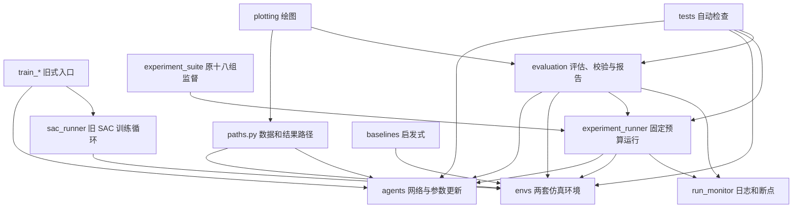

# Python 源码、来源与依赖地图

本文说明正式 Python 源码、自动化检查、示例和保存在 `outputs/` 的临时验证脚本各自做什么。项目安装包只包含 `src/satellite_rl/`；测试、示例和实验验证脚本都不会被训练入口自动调用。

## 文件数量与“历史 / 新增”的口径

当前源码包有 **58 个 Python 文件**，`tests/` 有 **23 个测试文件**，`examples/` 有 **2 个示例**；`outputs/experiments/` 与 `outputs/verification/` 中另有 **113 个单次实验或核验脚本**。最后一类脚本保存在实验产物旁，不能视为默认训练程序。

来源标记依据 [迁移清单](docs/工程文档/核验记录/01_源码迁移清单.json) 和 [迁移说明](docs/工程文档/01_项目迁移说明.md)：

- **历史**：迁移清单明确对应了旧项目文件。代码移入新目录，但主要算法或评估用途承接旧文件。
- **拆分**：把原来混在一个脚本中的训练入口、公共流程或包目录拆开放置；不等于新增一种算法。
- **新增**：迁移后增加的监控、公式核验、参数量接近的网络、六组实验与其配套检查。

“历史”描述代码来源，不表示文件已停用。`outputs/verification/performance_only_20260924/before/` 是提速前的整份源码快照，便于逐文件回滚，内容与源码表中同名文件重复，不能作为第二套运行代码。

## 各个正式源码文件

### 包入口、路径与动作设置

| 文件 | 来源 | 用途 |
| --- | --- | --- |
| `src/satellite_rl/__init__.py` | 拆分 | 包入口说明；导入时不启动实验。 |
| `src/satellite_rl/paths.py` | 拆分 | 把城市数据、预训练模型和输出位置映射到项目目录。其他模块通过它取路径。 |
| `src/satellite_rl/action_config.py` | 新增 | SAC 训练与评估共用的功率动作档位配置。 |

### 仿真环境 `envs/`

| 文件 | 来源 | 用途 |
| --- | --- | --- |
| `src/satellite_rl/envs/__init__.py` | 拆分 | 环境包入口。 |
| `src/satellite_rl/envs/satellite.py` | 历史 | 主环境：生成波束场景，推进频率槽/功率分配，累计干扰、速率、奖励并结束回合。六组 SAC 正式训练使用此环境。 |
| `src/satellite_rl/envs/satellite_variant_103.py` | 历史 | 从原 103 变体迁入的环境；保留其资源超限等行为差异。 |

### 算法 `agents/`

| 文件 | 来源 | 用途 |
| --- | --- | --- |
| `src/satellite_rl/agents/__init__.py` | 拆分 | 算法包入口。 |
| `src/satellite_rl/agents/sac_transformer.py` | 历史 | Transformer SAC：状态编码、三个动作头、Critic、Actor 和温度更新。 |
| `src/satellite_rl/agents/sac_cnn.py` | 历史 | 原 CNN SAC。 |
| `src/satellite_rl/agents/sac_mlp.py` | 历史 | 原 MLP SAC。 |
| `src/satellite_rl/agents/sac_cnn_matched.py` | 新增 | 参数量接近 Transformer 的 CNN SAC，用于规模对照。 |
| `src/satellite_rl/agents/sac_mlp_matched.py` | 新增 | 参数量接近 Transformer 的 MLP SAC，用于规模对照。 |
| `src/satellite_rl/agents/sac_math.py` | 新增 | SAC 共同使用的温度与完整联合双 Q 期望计算。 |
| `src/satellite_rl/agents/ppo_grouped.py` | 历史 | 按分组频率动作的 PPO 算法。 |
| `src/satellite_rl/agents/ppo_direct.py` | 历史 | 直接选择频率起点的 PPO 算法。 |
| `src/satellite_rl/agents/dqn.py` | 历史 | DQN 网络、回放经验和参数更新。 |

算法模块提供模型和更新方法；它们不负责队列、终态报告或实验排程。SAC 五种网络都使用 `sac_math.py` 中共享的公式函数。

### 训练入口和记录 `training/`

| 文件 | 来源 | 用途及当前范围 |
| --- | --- | --- |
| `src/satellite_rl/training/__init__.py` | 拆分 | 训练包入口。 |
| `src/satellite_rl/training/train_sac_transformer.py` | 拆分 | 原 Transformer SAC 的旧式训练入口；默认训练回合数沿用旧配置。 |
| `src/satellite_rl/training/train_sac_cnn.py` | 拆分 | 原 CNN SAC 的旧式训练入口。 |
| `src/satellite_rl/training/train_sac_mlp.py` | 拆分 | 原 MLP SAC 的旧式训练入口。 |
| `src/satellite_rl/training/train_sac_cnn_matched.py` | 新增 | 参数量接近的 CNN SAC 旧式训练入口。 |
| `src/satellite_rl/training/train_sac_mlp_matched.py` | 新增 | 参数量接近的 MLP SAC 旧式训练入口。 |
| `src/satellite_rl/training/sac_runner.py` | 拆分 | 多种 SAC 共用的原训练循环；旧式 `train_sac_*` 入口调用它。 |
| `src/satellite_rl/training/train_ppo_direct.py` | 拆分 | 直接选频率起点 PPO 的旧式入口。 |
| `src/satellite_rl/training/train_ppo_grouped.py` | 拆分 | 分组频率 PPO 的旧式入口。 |
| `src/satellite_rl/training/train_dqn.py` | 拆分 | DQN 旧式训练入口。 |
| `src/satellite_rl/training/ppo_direct_utils.py` | 历史 | 直接动作 PPO 的旧训练工具。 |
| `src/satellite_rl/training/ppo_grouped_utils.py` | 历史 | 分组动作 PPO 的旧训练工具。 |
| `src/satellite_rl/training/run_monitor.py` | 新增 | 保存单次运行的事件、回合/更新日志和原子状态快照，支持恢复检查点。 |
| `src/satellite_rl/training/experiment_runner.py` | 新增 | 固定交互步数、随机种子和场景的单次 SAC 运行入口；恢复训练并写入终点/验证结果。此次六组正式运行直接调用它。 |
| `src/satellite_rl/training/experiment_suite.py` | 新增 | 原十八组 SAC 队列的准备和监督入口。它属于已取消的旧范围；旧监督已停止，勿用它重启旧十八组。 |

六组正式训练中，`experiment_runner.py` 创建算法与主环境、执行交互和参数更新，并调用 `run_monitor.py`。旧式 `train_sac_*` 脚本和 `experiment_suite.py` 都不是这六个作业的工作进程入口。

### 评估与分析 `evaluation/`

| 文件 | 来源 | 用途及范围 |
| --- | --- | --- |
| `src/satellite_rl/evaluation/__init__.py` | 拆分 | 评估包入口。 |
| `src/satellite_rl/evaluation/compare_metrics.py` | 历史 | 加载原模型权重并比较既有指标。 |
| `src/satellite_rl/evaluation/demand_sweep.py` | 历史 | 按业务需求档扫描并保存满意度/匹配指标。 |
| `src/satellite_rl/evaluation/compare_beam_satisfaction.py` | 历史 | 原逐束满意度对照入口。 |
| `src/satellite_rl/evaluation/checkpoints.py` | 新增 | 严格读取算法权重；缺失或结构不符时明确报错。 |
| `src/satellite_rl/evaluation/terminal_metrics.py` | 新增 | 统一按全部目标波束的终态速率计算需求满足率、SGM 和资源指标。 |
| `src/satellite_rl/evaluation/experiment_report.py` | 新增 | 原十八组方案的终点、基线和学习过程报告；硬性按十八组范围读取，属历史工具。 |
| `src/satellite_rl/evaluation/experiment_curves.py` | 新增 | 原十八组方案的验证曲线汇总；属历史工具。 |
| `src/satellite_rl/evaluation/final_analysis.py` | 新增 | 原十八组后处理的运行时长和行为诊断；属历史工具。 |
| `src/satellite_rl/evaluation/post_training_checks.py` | 新增 | 原十八组的条件、环境和推理评价；保留历史入口，不负责此次单种子补评。 |
| `src/satellite_rl/evaluation/post_training_handoff.py` | 新增 | 原十八组补评的后台串行管理器。用户取消多种子后已停用。 |
| `src/satellite_rl/evaluation/post_results_summary.py` | 新增 | 汇总原十八组条件评价和环境对照，范围仍是旧十八组。 |
| `src/satellite_rl/evaluation/update_timing.py` | 新增 | 为原十八组比较完整参数更新耗时；此次单种子比较改用下方 `single_seed_update_timing.py`。 |
| `src/satellite_rl/evaluation/single_seed_scope.py` | 新增 | 从旧运行目录严格挑出六个种子 51001 运行，并以每个运行状态及实际进程校验完成情况。 |
| `src/satellite_rl/evaluation/single_seed_postchecks.py` | 新增 | 当前六组的需求/次序条件、历史权重环境对照和推理计时入口。 |
| `src/satellite_rl/evaluation/single_seed_update_timing.py` | 新增 | 在终点模型副本上，以共同回放批次测量六个模型完整参数更新耗时。 |
| `src/satellite_rl/evaluation/single_seed_analysis.py` | 新增 | 为六组、单训练种子生成终态比较、同场景基线、收敛曲线和动作/资源分析。 |

旧十八组工具和六组单种子工具具有不同的完成门槛；运行前应确认范围。本轮正式补评结果位于 `outputs/experiments/sac_comparison_20260924_r2/single_seed_51001/`。

### 基线和绘图 `baselines/` 与 `plotting/`

| 文件 | 来源 | 用途 |
| --- | --- | --- |
| `src/satellite_rl/baselines/__init__.py` | 拆分 | 基线包入口。 |
| `src/satellite_rl/baselines/fixed.py` | 历史 | 固定频率槽、功率的参照分配策略。 |
| `src/satellite_rl/baselines/greedy.py` | 历史 | 按需求逐步选择资源的贪心策略。 |
| `src/satellite_rl/baselines/random_policy.py` | 历史 | 随机动作基线，不等于训练算法。 |
| `src/satellite_rl/baselines/four_color.py` | 历史 | 四色频率策略。 |
| `src/satellite_rl/baselines/graph_coloring.py` | 历史 | 图着色启发式分配。 |
| `src/satellite_rl/baselines/lagrangian.py` | 历史 | 拉格朗日约束分配基线。 |
| `src/satellite_rl/plotting/__init__.py` | 拆分 | 绘图包入口。 |
| `src/satellite_rl/plotting/plot_rate_comparison.py` | 历史 | 原吞吐率/速率比较图。 |
| `src/satellite_rl/plotting/plot_demand_satisfaction.py` | 历史 | 原需求曲线绘图入口。 |

### 测试 `tests/`

这些测试均是项目迁移后的验证代码，不是训练或评估入口。

| 文件 | 检查内容 |
| --- | --- |
| `tests/test_structure.py` | 包导入、依赖方向和路径结构。 |
| `tests/test_agent_fixes.py` | SAC 梯度边界、数值和损失计算修正。 |
| `tests/test_sac_joint_formula.py` | 目标熵更新方向、联合动作双 Q 及梯度。 |
| `tests/test_matched_sac.py` | 参数量接近的 CNN/MLP 网络、初始化和更新。 |
| `tests/test_terminal_metrics.py` | 全目标波束终态指标及 SI/SGM 区分。 |
| `tests/test_terminal_allocation.py` | 终态分配、零槽及资源统计。 |
| `tests/test_evaluation_fixes.py` | 固定场景评价和结果字段。 |
| `tests/test_environment_physics.py` | 两套环境的功率、干扰和顺序计算。 |
| `tests/test_atomic_replace.py` | Windows 文件占用下的安全文件替换。 |
| `tests/test_env_performance.py` | 环境热点及缓存提速。 |
| `tests/test_sac_performance.py` | 多种 SAC 的等价参数更新。 |
| `tests/test_training_performance.py` | 训练线程设置与过程等价性。 |
| `tests/test_experiment_runner.py` | 单次训练配置、记录及断点恢复。 |
| `tests/test_experiment_suite.py` | 原十八组历史队列门槛和运行规则。 |
| `tests/test_experiment_curves.py` | 原十八组验证曲线汇总。 |
| `tests/test_post_training_checks.py` | 原十八组补充评价的输入门槛和核对逻辑。 |
| `tests/test_post_training_handoff.py` | 原十八组后台补评交接管理器。 |
| `tests/test_post_results_summary.py` | 原十八组补评汇总。 |
| `tests/test_final_analysis.py` | 原十八组训练行为和耗时分析。 |
| `tests/test_update_timing.py` | 原十八组完整更新耗时口径。 |
| `tests/test_single_seed_scope.py` | 六组单种子的范围和实际运行身份校验。 |
| `tests/test_single_seed_post_eval.py` | 六组补充评价、WDDM 桌面负载分类及计时索引。 |
| `tests/test_single_seed_analysis.py` | 六组报告、基线配对、曲线和原始文件校验。 |

### 示例 `examples/`

| 文件 | 来源与用途 |
| --- | --- |
| `examples/graph_coloring_draft.py` | 由历史 `cnn.py` 草稿移入；是图着色草稿，不是 CNN 神经网络。 |
| `examples/numpy_random_state_demo.py` | 由历史 `test.py` 移入；演示 NumPy 随机状态，不属于自动测试或模型训练。 |

## 模块之间怎样调用

依赖方向的重点：`agents/` 负责网络更新，不依赖 `training/` 的入口；`training/` 负责把算法、环境、路径和记录接起来；基线与评估模块调用环境及算法；`paths.py` 统一定位资产。训练与评估之间存在少数为报告/指标共享数据的反向导入，不是完全分层的单向结构。`experiment_suite.py` 是已取消十八组方案的调度代码，而本轮六组状态与报告分别在 `single_seed_scope.py`、`single_seed_analysis.py`、`single_seed_postchecks.py` 和 `single_seed_update_timing.py` 中处理。

包外部运行库由 `pyproject.toml` 声明：PyTorch、NumPy、pandas、Matplotlib；其他辅助逻辑主要使用 Python 标准库。正式六组训练使用 `DQN` Conda 环境中的 CUDA PyTorch。运行时包入口由 `python -m ...` 解析；导入模块本身不会自动启动训练。

## 实验目录中另存的一次性 Python 脚本

以下脚本都位于 `outputs/`，用于某次场景、源码版本和结果的复核或性能探针；**不属于可导入的 `satellite_rl` 包，也不是常规训练入口**。每个文件的输入、输出和适用版本以同目录的 JSON 清单或中文报告为准。

| 目录 | 脚本文件 | 用途 |
| --- | --- | --- |
| `outputs/experiments/coverage_reward_20260924/` | `baseline_eval.py`、`old_weight_eval.py`、`finalize_comparison.py` | 基本服务优先奖励候选讨论配套的启发式基线与旧权重离线对照、结果归并；是候选方案诊断，不是已批准的新训练。 |
| `outputs/experiments/sac_comparison_20260924/calibration/` | `calibrate_cuda.py`、`calibrate_3v6.py`、`finalize_3v6.py`、`tensorboard_launcher.py` | 旧 CUDA 模型速度与并行度试测；六路试测失败后存档；本地曲线服务启动器。 |
| `outputs/experiments/sac_comparison_20260924_r2/` | `tensorboard_launcher.py`、`transition_old_queue.py`、`verify_scene_lineage.py` | 六组改为当前历史十八组前的界面启动、旧队列和场景来源核验脚本。 |
| `outputs/experiments/sac_comparison_20260924_r2/recovery_20260924_092153/` | `record_recovery.py` | 断电后的备份与续训记录。 |
| `outputs/experiments/sac_comparison_20260924_r2/verification_first_completed/` | `verify_first.py`、`check_remaining_checkpoints.py`、`check_resource_accounting.py` | CNN 原公式首组的终点、检查点和资源账核验。 |
| `outputs/experiments/sac_comparison_20260924_r2/verification_first_completed/` | `verify_first.py`、`check_remaining_checkpoints.py`、`check_resource_accounting.py` | CNN 原公式首组的权重、考核和资源账核验。 |
| `outputs/experiments/sac_comparison_20260924_r2/verification_transformer_legacy_s51001/` | `verify_first.py`、`check_remaining_checkpoints.py`、`check_resource_accounting.py`、`check_transformer_initialization.py` | Transformer 原公式 51001 的终点、检查点、资源账和公式配对初值核验。 |
| `outputs/experiments/sac_comparison_20260924_r2/verification_transformer_corrected_s51001/` | `verify_first.py`、`check_remaining_checkpoints.py`、`check_resource_accounting.py`、`check_mlp_initialization.py` | Transformer 修正公式的终点、资源和 MLP 初始配对核验。 |
| `outputs/experiments/sac_comparison_20260924_r2/verification_cnn_corrected_s51001/` | `verify_first.py`、`check_remaining_checkpoints.py`、`check_resource_accounting.py` | CNN 修正公式的终点与约束核验。 |
| `outputs/experiments/sac_comparison_20260924_r2/single_seed_51001/` | `verify_formal_analysis.py`、`handoff/single_seed_handoff.py`、`state_diagnosis/reproduce_alias.py`、`sources/satellite_before_c4963ba.py` | 六组正式报告的哈希核验；原十八组交接记录；204 维观测的小例复算；修正前环境源码快照。 |
| `outputs/experiments/sac_comparison_20260924_r2/single_seed_51001/handoff_repair1/`、`handoff_repair2/` | 各自的 `repair_handoff.py` | 首次遇到 Windows 桌面进程误判后使用的新后处理交接脚本；最终修复版位于 `handoff_repair2/`。 |
| `outputs/verification/baseline_recheck_sac_r2_20260924/` | `run_baseline_recheck.py`、`run_power_counterfactual.py` | 同场景贪心/固定策略复核，以及仅改变轨迹功率的说明性重放。 |
| `outputs/verification/concurrency_review_20260924/` | `review_partial.py` | 重算同三作业串行、两路和三路短试测耗时。 |
| `outputs/verification/coverage_baseline_20260924/`、`greedy_20260924/`、`learning_evidence_20260924/` | `analyze_saved_results.py`、`evaluate_greedy.py`、`evaluate_learning.py` | 保存结果覆盖范围、贪心策略及历史学习证据核验。 |
| `outputs/verification/cuda_perf_20260924/`、`gpu_env_feasibility_20260924/` | `network_probe.py`、`network_alpha_probe.py`、`network_action_probe.py`、`env_candidates.py`、`kernel_probe.py` | CUDA 前向、动作、温度更新、环境 GPU 化候选与小型可行性探针。 |
| `outputs/verification/dqn_cuda_repair_20260924/` | `verify_cuda.py`、`repair_entrypoints.py`、`download_torch.py`、`download_mkl.py` | DQN CUDA 环境核对、旧入口导入修复，以及当时安装依赖时用过的下载脚本。不是日常环境安装程序。 |
| `outputs/verification/design_audit_20260924/`、`env_correctness_20260924/`、`run_reliability_20260924/` | `environment_checks.py`、`record_fixture.py`、`record_old_fixture.py`、`windows_lock_probe.py` | 环境确定性检查、旧/新环境输入快照及 Windows 文件句柄更换探针。 |
| `outputs/verification/model_policy_audit_DQN_20260924/` | `run_audit.py`、`verify_and_plot.py`、`analyze_preferences.py`、`analyze_generalization.py` | 早期 DQN 策略行为、场景变化及图表复核。 |
| `outputs/verification/performance_only_20260924/` | `env_apply.py`、`env_verify.py`、`network_verify.py`、`pipeline_verify.py` | 性能提速前后环境、网络更新和短循环的数值对照。 |
| `outputs/verification/performance_only_20260924/before/src/`、`before/tests/` | 共 42 个 Python 源文件快照和 5 个旧测试快照 | 性能优化前源代码和测试的回滚参照；逐文件与上文当前源码/测试表对应，不应从此目录运行。 |
| `outputs/verification/sac_architecture_20260924/` | `math_probe.py`、`state_probe.py` | SAC 公式数值与状态观测能力小例。 |
| `outputs/verification/single_seed_analysis_20260924/`、`single_seed_hash_fix_20260924/` | `qa_full_report.py`、`verify_qa.py`、`real_hash_probe.py` | 更正正式报告前所用的临时报告预演及 Windows 路径哈希探针；正式报告应使用 `single_seed_analysis.py`。 |
| `outputs/verification/training_perf_20260924/` | `profile_env.py`、`profile_network.py` | 单环境推进和网络更新耗时剖析。 |

以上分组覆盖本次清点到的 113 个 `outputs/**.py` 文件。不同实验目录的同名 `verify_first.py` 有各自对应的 `run_id` 和权重，不是可互换的通用入口。
