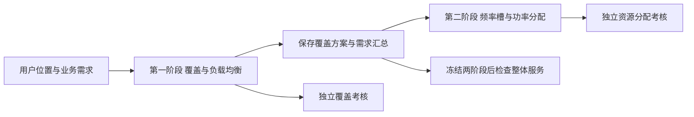

# 01 第一阶段波束覆盖规划与两阶段解耦方案

日期：2026-09-30。状态：**方案讨论已完成，算法尚未实现，效果待验证；未创建训练或评价任务，未批准新增预算。** 本轮按 `satellite-rl-change-eval` 的方案审查和纯文档分支核查，依据开题报告、现行代码及已完成第二阶段结果提出建议。

建议以“有约束的初始覆盖布局＋单智能体集中轮询修正”为第一阶段主线。第一阶段独立研究覆盖和负载均衡；第二阶段沿用频率槽和功率分配职责。两者共享物理定义，通过版本化覆盖方案衔接，分别训练、分别考核。首版固定100束和0.5°宽度，先验证中心调整；之后扩展逐束宽度，才完整覆盖开题报告中“指向与宽度联合调整”的研究目标。

## 1 开题报告与当前工作的关系

[开题报告](../../资料/01_开题报告_导出1212最终版.docx)第2.1节第一部分明确研究波束指向和宽度，以覆盖和负载均衡为目标，并采用单智能体集中式轮询决策。第二部分把覆盖小区内的业务汇总为波束中心处的“超级用户”，再分配频率与离散功率。报告还提出覆盖方案以较慢周期更新。这些内容支持分层接口，并不要求两个智能体联合训练。

第一阶段要回答“业务在哪里，哪些用户归哪个波束，波束如何覆盖”；第二阶段要回答“在给定覆盖方案下，每束分多少频率槽与功率”。第一阶段的覆盖率表示业务落入可服务波束范围，第二阶段的需求满足率表示最终容量满足多少需求。两者应分别记录，不能互相替代。

现有航空场景已具备真实位置驱动的合成业务、过渡覆盖器、需求汇总、冻结场景和第二阶段工作台流程。过渡覆盖器从正需求位置选100个代表中心，按0.25°卫星视角半径唯一归属用户；它不是第一阶段DRL。已有G08六组训练及七模型共同考核均完成，清单状态为 `completed_formal_training_common_evaluation_and_report`。本轮只核对清单、报告与源码，没有刷新服务运行状态，也没有恢复任何历史任务。

[报告07](../../第二阶段/实验报告/07_欧洲六组独立场景对照.md)中，A的共同考核需求满足率91.40%、SGM0.5741、平均功率1680.17W；B分别90.99%、0.5198、2164.73W，B的全100束基本服务比例70.00%高于A的59.67%。这些是原100束过渡布局上的单训练种子结果，可作为衔接参照，不能用作第一阶段新布局的预期成绩。A与B的设置分别验证，尚未证明组合使用的收益。

## 2 两阶段怎样解耦

**目标与学习分开。** 第一阶段根据覆盖、负载不均和重配置代价学习，不把T-SAC回报、SI或SGM作为训练奖励，不在第一阶段动作中选择频率槽或功率。它有自己的网络、回放或轨迹、权重和训练预算。第二阶段从已保存的覆盖方案读取位置和汇总需求，有自己的训练过程；第一阶段更换算法时，不要求第二阶段同步在线学习。

**物理定义共同。** 用户是否落入波束、波束宽度的含义、可视范围、天线方向图和输入单位必须一致。解耦允许模块独立更换，仍须保持接口和物理口径一致。第一阶段可使用固定几何关联或固定参考链路估计来抑制不利布局；这类估计不调用某个第二阶段策略，也不能冒充实际同频干扰或最终容量。

**运行周期分开。** 首版把每个时刻的业务图作为静态快照，第一阶段输出后，在第二阶段整轮资源分配中固定中心、宽度和归属。后续真实时序版本再明确覆盖更新周期与资源更新周期：覆盖周期内不移动中心，但每个资源快照可根据当前用户位置重新判断归属、汇总需求。训练数据按时间连续出现不等于已经建立这种时序环境。

**接口建议保存两层数据。** 底层保存用户ID、位置、需求、时间、可视性、未覆盖标记；覆盖层保存稳定波束ID、中心、宽度、用户归属、汇总需求、版本，以及导出后的处理顺序和组号映射。用

\[
D_i=\sum_u a_{ui}d_u,\qquad a_{ui}\in\{0,1\},\quad \sum_i a_{ui}\leq1
\]

汇总需求，且必须满足“各束需求之和＋未覆盖需求＝底层总需求”。重叠区域采用固定、可复现的唯一关联规则。初期可用覆盖范围内最小卫星视角距离，平局按稳定ID处理；它未必最有利于均衡，若后续增加负载感知关联，应作为独立因素检验，不能悄悄与中心策略一起改变。

## 3 四个可选方案

| 方案 | 第一阶段怎么决策 | 与已有工作的延续 | 主要代价与适用情况 |
| --- | --- | --- | --- |
| A 逐束构建覆盖方案 | 单智能体依次从离散候选波位选择中心，再按该中心选择宽度，直到形成100束布局 | 接续报告的离散波位、集中轮询；固定宽度输出可转为现有场景 | 需处理前期选择造成的后期覆盖困难；适合希望主要布局由DRL直接生成 |
| B 初始布局加DRL修正 | 有约束覆盖规则先生成布局；单智能体轮询各束，选择保持、移动到邻近候选波位，后续加入宽度调整 | 复用现有业务、归属和汇总流程，保留稳定波束ID；最适合先接上第二阶段 | 受初始布局和局部动作范围影响，必须分开证明初始化与学习贡献；推荐主线 |
| C 覆盖方案库加DRL选择 | 用冻结规则预生成合法布局库；智能体按当前业务和上一布局选择方案 | 统一输出相同格式，便于快速检查接口和重配置 | 能力受库内方案限制；单快照一次选方案只是上下文决策，研究长期切换才需时序MDP |
| D 区域分层规划 | 单一集中决策体系先给业务区域分配波束数量，再逐束确定中心与宽度 | 最终仍导出同一覆盖方案，可处理更大范围和多热点 | 区域边界、配额与局部覆盖之间又多一层设计；当前建议作为扩展 |

四个方案都是候选研究路线，未验证优劣，不建议一次启动四套正式训练。

### A 逐束构建覆盖方案

状态包含业务栅格或用户集合、已放置波束、未覆盖需求、每束负载和剩余波束数。每次动作选择一个候选中心，宽度先固定；可变宽度版采用“先选中心，再在该中心合法宽度中选档位”的条件动作。候选网格遵循开题报告的离散波位设定，但网格间隔须通过星地几何和候选覆盖误差确定，不能把固定经纬度步长当作等距离。

动作掩码可筛掉不可视、越过允许指向边界、超过宽度范围和违反已定义间距的候选。还需考虑剩余波束能否覆盖剩余业务；仅筛掉当前非法动作不保证最后全覆盖。保留未能完成覆盖的场景，记录失败位置，必要时采用版本化的回退规则并单独统计其贡献。

建议以独立的带动作掩码PPO作为首个实现候选，使用集合或栅格编码全局业务信息；后续可比较离散SAC。PPO是候选算法选择，不能据原论文断言它在本项目比SAC更稳定。[PPO原论文](https://arxiv.org/abs/1707.06347)给出策略优化方法；[动作掩码研究](https://arxiv.org/abs/2006.14171)讨论策略梯度算法中排除非法动作的依据。掩码仍需要本项目自己的几何和终态检查。

### B 初始布局加DRL修正

先构建一个有约束的需求加权聚类或贪心覆盖基线，检查100束、可视性、覆盖和正需求等条件。聚类中心本身不保证全覆盖，需要明确检查、修补和失败退出规则。初始化可采用现有代表中心逻辑作为参照，但不能直接称它已经是满足所有覆盖目标的可行解。

建议第一版保持固定轮询顺序和固定轮询次数，每次只修改一束；可选动作为保持或移动至邻近离散波位。邻域大小和轮询次数在训练前确定。宽度扩展后再增加相邻宽度档位动作。保存每次提议、实际动作和回退原因，不把规则替代动作算作策略正确选择。

每次中心或宽度改变后，全量重算用户覆盖资格、唯一归属、所有波束负载与未覆盖需求。一个中心移动会影响其他束的用户归属，不能只更新当前束的需求。几何非法动作使原状态保持；如果合法性检查依赖全量归属，应对候选结果完成检查后再提交动作。固定宽度下仍无法形成100个正需求波束的场景，要保存并纳入失败统计。

第一阶段奖励可以表达为覆盖需求增加、负载不均减少，再扣除重配置与几何重叠代价。覆盖率阈值应同时作为最终可行性条件；达不到阈值的布局不能仅靠较高均衡奖励成为主结果。先在静态快照证明修正有效，再研究相邻时刻以上一次布局为初值的动态调整。

它的研究价值应落在“学习如何在有限修正次数内兼顾覆盖、负载与重配置”，而非仅仅换用一个神经网络。开题报告引用的[需求驱动自适应波束布局论文](https://orbilu.uni.lu/handle/10993/49263)已有基于用户空间聚类的可变位置与尺寸方法；因此仅做需求加权聚类本身不足以说明本方案的新贡献。是否有创新仍需对照结果与进一步文献核对。

### C 覆盖方案库加DRL选择

通过训练数据和预先冻结的生成规则建立布局库，例如均匀、航路、多热点等布局，记录中心、宽度和可服务范围。策略观察当前业务图、上一布局及切换代价，从库中选一项；相邻业务时刻形成状态转移。库不足造成的不可覆盖必须报告。

最有用的对照是“固定方案”“按当前覆盖与负载贪心选方案”“在相同库中学习选择”。库生成规则不能利用最终考核结果调参；对考核业务输入执行冻结规则属于正常推理，用考核成绩挑选库或阈值属于开发。此方案适合做快速衔接与动态切换参照，但对任意新布局的能力受限。

### D 区域分层规划

先根据空间业务为区域分配波束配额，再在每区选择中心和宽度，总束数仍受统一预算约束。层次发生在第一阶段内部，第二阶段仍只接收最终布局；无需增加多个互相学习的波束智能体。

区域边界附近的用户、跨区覆盖和区域负载迁移会使问题变复杂。建议在A或B完成100束验证之后再考虑此路线。现阶段不把它列为首批实现任务。

## 4 推荐先做什么

### 第一步 明确目标和几何范围

从现有欧洲航空数据起步，沿用13°E卫星和现有可视性约定，保存实际用户位置及合成需求假设。先检查固定100束、0.5°宽度和候选波位是否能达到预定覆盖条件；几何可覆盖不意味着功率和频率预算足以满足全部业务。

2026-09-30追问核对：可直接复用已有航空数据的逐机位置与合成需求。现存训练576、验证20、原考核100个场景及对应逐机明细。第一阶段输入应从 `outputs/experiments/europe_adsb_20260928/preflight/staged_scenes/<用途>/source_observations_*.jsonl.gz` 读取，不仅使用100束汇总NPZ；原覆盖归属仅作参照，动作后重新计算。训练复用01-08/09、验证复用01-12，已分析的01-15/18留作开发衔接，新最终考核另留。连续动态控制还需构造按飞机ID和UTC排序、处理缺测与需求相关性的序列。本次核对不授权或启动训练，详见[追问记录](../../../Q&A/环境仿真/第一阶段波束覆盖规划与两阶段衔接.md)。

第一阶段至少报告需求覆盖比例、用户覆盖比例、未覆盖用户数和需求、束负载离散度、最大束负载、空束数、重配置幅度与推理时间。报告中的“全覆盖”需要说明对象是服务区域内全部目标用户、正需求用户还是全部业务需求；不能只覆盖大需求用户后称全覆盖。

建议保留开题报告的负载标准差，同时记录标准差/平均负载，用于总需求变化时比较。后者只是无量纲的负载不均程度，不取代原指标。固定底层业务总量，不能丢掉高需求用户来降低负载离散度。零总需求单列处理。可变宽度导致名义承载能力不同后，应把纯需求均衡与固定参考容量下的负载比例分开，不把等需求直接称为等资源压力。

### 第二步 完成不含DRL的覆盖基线和接口检查

实现固定参考布局、有约束聚类/贪心布局以及确定性局部搜索。用小例子检查重复覆盖只计一次、边缘用户、用户跨束、移动引起的全局归属变化、空束、不可覆盖和需求守恒。保存一个完整覆盖结果，先证明能按正确位置、距离、单位和顺序转换为第二阶段场景。

当前第二阶段入口严格要求100束、正需求及相应位置/距离数组；CSV使用 `beam_id,lat,lon,demand_mbps`，NPZ可保存完整物理字段。现有方向图为固定全局0.5°，场景没有逐束宽度字段。第一版只改中心和汇总需求，保持8组×100槽、每槽25MHz、3000W及既有动作口径，能延续现有环境；不需要把第一阶段的覆盖动作塞入原T-SAC的频率/功率动作头。

第一阶段内部保留稳定波束ID，导出时使用冻结的适配规则。当前第二阶段组号由处理序号%8决定，航空场景按需求降序导出；需求变化会隐式换组。因此必须保存ID、处理顺序与组号映射，在所有候选布局中使用同一规则，说明衔接结果包含这一既有分组规则的作用。第一阶段不能自行分配频率组，又把它称为仅覆盖规划的收益。

### 第三步 独立实现并筛选B的学习修正

建立独立覆盖环境、单智能体网络和学习入口，先固定中心动作、宽度、关联规则及轮询次数。用覆盖目标筛选模型，第二阶段不参与梯度、奖励或保存节点选择。首个模型可采用带合法动作筛选的PPO；如选离散SAC，同样保持独立动作与目标，不能直接复用旧资源分配权重。

主对照应至少包含B0“同一初始化无修正”、B1“同一初始化＋非学习局部搜索”、B2“同一初始化＋DRL修正”。B1与B2使用相同合法邻域、轮询/候选评估预算或明确报告计算差异。逐场景展示初始化到修正的差值，统计成功与失败，才能区分初始覆盖器、额外计算和学习策略各自的贡献。

本轮不指定未经测量的正式训练步数，也不机械沿用第二阶段40万步：移动一次中心与分配一次频率/功率的工作量不同。后续先测几何更新成本和有效更新，再提出单训练种子51001、固定交互预算及模型选取规则。预算和训练任务另行确定，不新增51002/51003。

### 第四步 冻结两阶段做衔接验证

冻结第一阶段，导出新覆盖场景；优先固定A作为平均服务/匹配/功率参照，B作为全体基本服务参照，按其原有输入/动作版本加载。相同底层用户业务经过不同覆盖方案后，上层位置和需求不同，这是研究的干预因素；其余物理条件、适配规则与第二阶段策略保持相同。旧策略能加载只说明接口兼容，在新布局下的服务效果仍须重评。

衔接结果单列波束SI、SGM、基本服务、功率、槽数及约束。还要计入未覆盖业务。中心代表用户模型无法直接给出真实逐用户速率，可在明确“束内按需求比例分配容量”的假设下，用

\[
\eta_{\mathrm{effective}}=
\frac{\sum_i\min(C_i,D_i)}{\sum_u d_u}
\]

表示总请求中有效承载的比例，分母包括未覆盖需求。此值是需求加权的总业务指标，不等于100束SI，也不证明每个真实用户的SINR或速率达标。真正逐用户服务需要扩展束内链路评价。本轮没有计算该新指标或新增模型评价。

冻结旧T-SAC适合检查现成策略对新布局的适应，不能据其下降断言第一阶段覆盖方案更差。若要证明完整系统的学习效果，后续应在共同冻结的覆盖场景分布上训练并评价第二阶段；只有需要区分布局分布适应的贡献时再讨论额外训练矩阵，避免每个候选覆盖器各自无限重训。

### 第五步 扩展宽度和真实时序

中心方案通过后，另立逐束宽度物理版本，把宽度、覆盖边界、增益、方向图及交叉波束干扰贯通到第二阶段。不能扩大覆盖圆却保留旧增益和固定方向图。需要同步场景格式、前端配置/校验、冻结任务、状态输入、动作、模型及断点元数据，再按新环境同条件训练和考核；历史权重仅作兼容性明确的受限参照。固定宽度首版不能声称已完成报告中完整的第一阶段研究。

真实动态阶段使用连续航空时序，加入上一次布局、移动/宽度变化、用户换束及覆盖持续性成本。评价业务突变和迁移时的恢复过程，与每个时刻从头规划比较。静态集合上的不同快照成绩只能说明跨快照适应，不能当成动态跟踪已验证。

## 5 验证和论文如何组织

第一阶段正文独立说明问题、覆盖约束、MDP、策略与基线，只用覆盖和负载相关证据证明本阶段结果。第二阶段正文说明给定布局后的资源分配，保留已有T-SAC、动作掩码及资源账成果。最后另设衔接实验，回答更好的覆盖是否也带来更好的有效业务承载和资源使用。覆盖改善并不必然提高SGM或降低功率，均衡需求也不必然减轻同频干扰。

训练、验证、考核按日期、连续轨迹片段或业务家族划分，避免相邻高度相似快照跨集合。现有01-18已用于G08结果分析，第一阶段在依据这些结果设计后，不能再把同批快照称为从未用于本研究开发的最终考核；可保留作开发衔接参照，正式考核另留新数据。

正式报告附原始与平滑训练曲线、覆盖/负载验证曲线、未覆盖需求分布、推理耗时、时序重配置曲线及衔接服务/资源图。与方案有关的失败场景全部保留，说明同快照动作重复的口径。正式训练和长评价需先接入第一阶段工作台任务类型及所选参数，使用DQN/CUDA、冻结源码和后台子agent；这是未来实施要求，本轮没有新任务。

## 6 本轮核查与实现入口

- [场景校验与状态构建](../../../src/satellite_rl/workbench/environment.py)：100束正需求、物理字段、状态布局及按处理序号分组。
- [航空过渡覆盖与需求汇总](../../../src/satellite_rl/workbench/aviation.py)：代表中心、0.25°唯一归属及需求降序导出。
- [CSV与NPZ导入](../../../src/satellite_rl/workbench/datasets.py)：输入格式与冻结数据。
- [卫星区域配置](../../../src/satellite_rl/envs/regions.py)：欧洲13°E与可视性约定。
- [方向图和资源物理模型](../../../src/satellite_rl/envs/satellite.py)：固定0.5°、100束及资源预算。
- [模型严格加载](../../../src/satellite_rl/workbench/checkpoints.py)：输入/动作、配置语义和权重匹配。
- [前期衔接方案04](../../方案/04_训练场景泛化与第一阶段衔接方案.md)：保留历史讨论，新第一阶段算法路线以本方案为建议。
- [读取证据与来源SHA](../../../outputs/verification/stage1_plan_review_20260930/review_evidence.json)：正文提取、代码/报告/正式清单指纹；不包含新增实验结果。

本轮仅新增文档和问答、更新目录与状态，核查来源、Markdown链接及Git差异；没有修改环境、网络或前端，未运行训练或长评价。由于页面操作与配置未改变，本轮无需前端同步。未来实施中心规划任务或逐束宽度时，工作台的配置、校验、任务记录、日志、模型和结果展示须同步。当前文档归档不表示相关算法或性能已验证。
