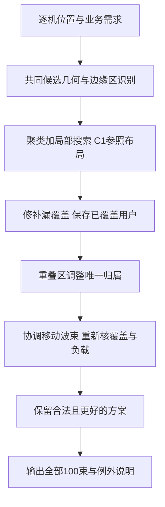

# 04 覆盖优先与主体波束负载均衡方案

日期：2026-10-04。状态：**供讨论确认，未实现、未启动训练或正式评价，效果待验证。** 候选实验编号为S1-02，尚无工作台任务ID、冻结科学提交或新权重。现有S1-01保持已完成状态。

建议把第一阶段目标明确为：**先尽力覆盖全部目标用户，再让绝大多数波束承担相近业务需求；确实为了覆盖偏远用户而必须保留的少数轻载波束，可以例外。** 保留全部波束的CV，同时增加主体波束CV、接近主体平均负载的波束比例和边缘专用波束明细。不能通过漏掉飞机、排除过载波束或事后挑选最均匀的90束来改善成绩。

推荐先做覆盖修补、重叠区用户归属和协调调位的非学习对照，确认固定100束、全宽0.5°下的改善空间，再训练PPO学习选择调整。这样既延续开题报告的集中式决策路线，也能区分几何与归属限制、目标设计和学习效果。

## 1 与开题报告的对应

[开题报告](../../资料/01_开题报告_导出1212最终版.docx)第2.1节第一部分提出调整波束指向与宽度，在保证覆盖的前提下实现负载均衡；采用单智能体集中式轮询决策。其负载来自波束内用户业务需求汇总，并要求一个用户不能重复接入多个波束。第二部分再将每个小区汇总为中心处的“超级用户”，分配频率槽与功率。

本方案保留覆盖优先、需求负载和单智能体主线，把本次提出的“少数边缘专用波束可轻载”写成明确例外规则。**主体波束CV及例外比例是本轮新增建议，不是开题报告原有指标。** 开题报告的负载标准差、全体覆盖率仍保留；CV用于比较不同业务总量下的相对不均程度。当前静态快照实验也不能代替报告中长期动态适应目标。

第一轮仍固定100束、全宽0.5°，只研究中心和唯一归属；这不能称为完成指向与宽度联合优化。逐束宽度另立物理版本，见第7节。第一阶段的覆盖是几何覆盖，负载是合成业务需求，均不等于最终链路容量、真实传输量或第二阶段SI。

原文定位可参阅[既有正文提取](../../../outputs/verification/stage1_plan_review_20260930/proposal_text.txt)的P141、P148–164和P166；正文中的公式为嵌入对象，本文公式是本轮明确拟定的统计口径，不依据缺符号的文本提取猜写原式。

## 2 现有结果与需要检验的机制

S1-01在相同2024-01-22的100个场景上完成七路线考核。下表摘录主要参照，覆盖是逐场景等权均值，CV也是逐场景CV均值；“原可行”仍按当时双覆盖至少99%、100有效束、无空束及几何约束判定。

| 编号与实验组合 | 需求覆盖 | 用户覆盖 | 全体负载CV | 原可行场景 |
| --- | ---: | ---: | ---: | ---: |
| C0 聚类基础布局不调整 | 99.8849% | 99.7977% | 0.840619 | 100/100 |
| C1 聚类基础布局加局部搜索 | 99.9391% | 99.8841% | 0.805150 | 100/100 |
| C2 聚类基础布局加PPO微调 | 99.9077% | 99.8370% | 0.844620 | 100/100 |
| P0 无基础布局的纯PPO逐束构建 | 99.4725% | 99.4788% | 0.794456 | 82/100 |

完整结果、配对差值和曲线见[报告02](../实验报告/02_七组覆盖规划独立场景对照.md)。C1是这批数据上的质量参照；P0的低CV伴随覆盖下降，不能宣布整体更好。也不能仅凭总体CV判断主体波束是否已经均衡，旧报告没有主体划分及其CV。

对归档C1终态按更严格门槛只读统计：双覆盖至少99.9%为50/100场景，双100%为36/100；64个场景仍有未覆盖用户，最多7架。该统计来自旧结果，不是重新评价或新训练；见[门槛复核](../../../outputs/verification/stage1_balance_plan_20261004/c1_threshold_review.json)。因此从99%提高到99.9%乃至100%本身就需要认真解决。

当前[覆盖环境](../../../src/satellite_rl/coverage/environment.py)和[配置](../../../src/satellite_rl/coverage/config.py)提供以下证据：

- 每用户归最近的有效覆盖波束，重叠区没有按负载分流的选择。
- 评分为需求覆盖×100＋用户覆盖－全体CV－移动代价；99%门槛用于最终可行性判断，动作筛选主要检查可视性与移动范围。提高覆盖权重仍不等于严格保证覆盖。
- R/C微调每次调整一束，只轮询两遍；局部搜索逐个试算9个候选，PPO依据压缩状态选择。其输入不含完整逐机覆盖关系。

这些是实现事实。它们是否分别造成主要效果损失，尚需对照。不能据此断言只改奖励或增加训练步数就一定解决。

## 3 把用户目标变成可检验的条件

以下数值均为**待确认的建议目标**，不表示固定几何下一定可达。

| 层次 | 建议条件 | 解释 |
| --- | --- | --- |
| 优先目标 | 用户覆盖与需求覆盖均100% | 必须同时未覆盖用户数为0、未覆盖需求为0，不能凭四舍五入显示100% |
| 接近全覆盖 | 两项均至少99.9% | 有限搜索未得到100%时单列；仍显示漏覆盖身份、数量、需求与原因 |
| 主体规模 | 经证据确认的例外最多10束 | 至少90束仍参加主体均衡；超过10束的场景如实标为主体规模目标未达 |
| 主体均衡 | 主体CV争取不超过0.20 | 目标是负载差异明显缩小，非每束严格相等 |
| 多数波束 | 全部100束中，至少90束属于主体且负载在主体均值的80%至120%内 | 分母固定100；不能将“主体中的90%”偷换成全部波束的90% |
| 过载检查 | 主体最大负载与均值比、P90和P95同时列出 | 不能靠排除高负载波束得到漂亮的主体CV |

CV属于一组波束，不能说某个波束自己的CV很低。主体CV和负载范围比例分别回答“这一大组差异有多大”和“到底有多少束接近平均”，两项需要一起看。范围内比例达标也不排除少量严重过载，故保留最大负载。主体均值是全部主体束实际汇总需求的算术平均，主体CV采用总体标准差除以该均值，与原全束CV同用总体标准差；统计单位统一为Mbps，转为bps时CV不变。用户覆盖按飞机条数计算，少于1000架时99.9%仍要求零漏飞机，因此必须同时报告漏覆盖人数。

**假设例子，非实验结果：**95束各100 Mbps，5个确需专束的边缘区域各10 Mbps。主体CV为0，95%的全部波束在主体均值附近；全体CV约0.205，允许保留这一差异。反之，5束严重过载不能以“尾部例外”为名删除。本方案只允许有覆盖必要性证据的轻载边缘例外。

先修补覆盖，再做均衡：进入均衡步骤后，默认不允许丢失修补后已覆盖的任何目标用户。候选调整必须全局重算并通过检查才接受；两束同时协调时按两束调整完成后的结果一次性判断。未到99.9%的场景保留覆盖修补失败状态，不丢弃、不偷偷降低门槛；100%没找到只说明在所用候选及计算预算内没找到。

几何覆盖独立定义为用户处于至少一个合法波束足迹内；每个可覆盖目标用户必须且只能分给其中一束。归属完整性单独核验，不能通过拒绝关联本来可覆盖的用户来降低负载。修补候选的接受结果首先保留C1已覆盖用户集合；在此条件下优先零漏覆盖，其次双99.9%达标，再按未覆盖用户数、未覆盖需求依次比较，最后才考虑均衡及移动。暂存过渡布局不受这一逐步比较限制，但最终提交必须完整通过；内部过渡不能被写成部署覆盖保证。

结果至少分为“全覆盖且均衡达标”“接近全覆盖且均衡达标”“覆盖达标但均衡未达”“覆盖未达”。另外单列几何合法性、空束与有效束数。逐场景比较优先检查覆盖及原有用户是否保留，再看主体均衡和耗时，不将各项混成一个总分宣布冠军。

## 4 怎样认定边缘专用波束

必须先依据该场景的用户位置、需求、合法候选波位及固定宽度确定边缘区域，再评价各算法。采用同一识别器、同一候选集合、同一参数和稳定用户ID；输入新场景后按冻结规则自动识别属于正常推理，不能人工看结果划分。

首版采用保守、可核验的充分条件：

1. 构造“哪些合法候选波位能覆盖哪些用户”的几何关系。两用户能被同一个合法候选覆盖时连接，取这一关系图的连通分量作为固定小区，不能人工拆分或合并。仅当一个非空分量全部用户可以被同一个合法波位覆盖时进入下一检查；不同分量间没有共同覆盖候选。于是，在这个共同候选集合内，完整覆盖本区确实至少需要一束，并且一束足够。保存全部分区、认证结果及SHA。
2. 该小区总需求低于全场景总需求/100的一半，认定为候选轻载边缘区。此0.5系数是待确认参数；因其作用于输入小区，不按某算法输出的负载挑低值。
3. 最终确有一束完整服务该小区且没有服务其他小区时，该束可作为一项例外。一个小区最多豁免一束；为同一区域人为放置多束，额外束仍计入主体。例外区未完全覆盖、身份无法核实或束内混入主体用户时不予豁免。
4. 无充分证据的低负载束仍计入主体。只在当前布局删一束会漏覆盖，不足以证明它在重新调位后也必不可少；不得用这一弱条件直接豁免。复杂边缘区可留作诊断，后续若引入精确覆盖可行性检查，须单独说明有限候选下的证据范围与求解超时。

该规则可能漏认一部分真实边缘情况，首版宁可记录“尚未认证”，也不把难以均衡的束全部解释成地理必然。候选集合有限，证明只适用于该集合与固定宽度，不能外推为连续空间的物理下限。不同方法须共享相同候选集合用于认证；若算法仍允许集合外中心，认证须补充这些位置并重新统一冻结后再使用。

超过10个符合条件的小区时，**不挑其中最有利的10个**：保存全部认证小区及其数量，该场景标记主体规模目标冲突，另列完整主体诊断，不进入“达标”统计。不同布局的束ID不能直接对应时，用预先冻结的区域和用户ID对应，报告每方法实际豁免束数与占用需求比例。

主体集合为全部100束去掉合格例外；主体包含空束、过载束和未认证轻载束。没有正需求或主体平均负载为0时，CV写不适用并标明失败，不能写0代表均衡。仍要求100束均为真实正需求束，沿用当前第二阶段接口；若这一要求和数据几何冲突，另提接口修订，不造需求填空束。

## 5 具体调整方法

**第一步，补覆盖。** 从C1起点逐一处理未覆盖用户及其附近业务，优先寻找能覆盖漏点、同时不丢原有用户的候选。必要时把能被邻束接替覆盖的冗余束移过去，或协调移动两束。全部100束的总需求账和唯一归属都要重算。工程上允许在临时副本中构造多步修补，最后整体核验再提交，不部署中途漏覆盖的状态。有限预算耗尽仍未达标时，保留最好已找到的覆盖方案及失败原因。

**第二步，利用重叠区分担业务。** 一架飞机落在两束覆盖内时，允许在两束之间选择唯一归属；从较重束转给较轻束，只有完整转移该用户需求后主体均衡改善且不产生非法/空束才接受。不能把一个用户拆成小数份同时分给多个波束，也不能把用户分给覆盖外的束。按稳定ID处理平局、每轮重新计算负载，限制扫描轮数并记录每次实际转移。

这一项改变原来的最近归属规则，必须独立比较。用户移到离中心更远的束可能影响链路条件，因此记录归属前后的离轴角、边界余量及换束用户数；几何合格不等于链路容量达标。第一阶段只声称改善需求分布，第二阶段的中心代表用户近似不能证明真实逐机服务没有下降。

**第三步，协调中心位置。** 优先给过载区域增加可分担的覆盖，同时保住边缘专用束。使用固定候选菜单：单束邻近移动、重叠邻束成对移动、将可安全撤出的非例外轻载束移向热点，并为原区域安排接替覆盖。一次两束调整按完整布局一起接受或拒绝，避免两束必须配合却任何单步都不能过关。保持动作始终合法；有限候选菜单仍可能停在局部结果，不保证全局最优。

新菜单允许比旧0.25°累计移动更大的安全重部署时，必须作为动作范围扩大单独标记。固定卫星、可视区、100束和0.5°宽度；从旧布局生成的中心、卫星视角合法网格及修补候选统一冻结为新菜单。不得把新旧差异全部归因于主体CV奖励。

均衡阶段建议按“先减少未落入合理负载范围的主体束数，再降低主体CV，再比较最大负载和调整幅度”的顺序选择搜索结果。训练可用平滑的负载偏差作为辅助信号，但最终验收始终用第3节的明示指标。覆盖保护独立于奖励，不能用降低CV抵扣漏覆盖。

**第四步，PPO学习选择调整。** 继续使用一个集中式策略，根据全部波束负载、覆盖缺口、边缘标记、当前待调束及候选可转移业务，选择有限菜单中的操作。补充的输入让模型能看到“哪些业务可以转移”，而不是只看各束总负载和粗栅格。候选生成与合法性检查也要计入推理耗时；若已经试算了全部候选的真实改善，学习方法须与“直接选最好候选”的搜索比较，不能隐去试算成本后声称模型提速。

PPO首轮只学习已达覆盖门槛之后的均衡修正。修补失败的场景没有可行均衡起点，任务仍记录为失败；训练中的未进入比例及全部场景评价结果均须公布。策略提议被拒、保持、实际执行、原始终态与最终采用结果分开记录。若使用保留中间最好布局作为最终输出，所有新方法采用同一冻结规则，同时报告PPO原始终态，不能把规则兜底的收益归给模型。

## 6 分步实验方案与候选预算

本轮只提交方案。建议先确认A阶段，取得其正式报告后再决定B阶段，避免在基础几何或指标尚不清楚时直接增加训练。

### A阶段 先验证覆盖与均衡方法

四条路线均不训练，编号为S1-02内部展示编号，不改历史C1编号和任务记录。

| 编号与实验组合 | 相对上一行增加什么 | 主要回答 |
| --- | --- | --- |
| A0 旧聚类加局部搜索C1 | 原实现参照 | 原覆盖、全体及新主体指标是多少 |
| A1 C1加覆盖修补 | 覆盖保护和修补菜单 | 能否先把覆盖提高到100%或99.9% |
| A2 C1加覆盖修补加负载感知归属 | 固定A1中心，只优化重叠区归属 | 最近归属限制了多少均衡空间 |
| A3 C1加覆盖修补加负载感知归属加协调调位 | 增加单束及成对移动菜单 | 固定宽度下还能改善多少 |

A1输出由A2/A3逐场景复用并记录SHA；A3先执行同A2归属步骤再追加协调调位。差值表写全双方实验组合，归属与中心变化分开。A0仍执行原合法动作/评分，不把新规则套进去后冒称原C1；所有路线在最终评价时统一计算新指标与新覆盖门槛。

建议开发数据：原2024-01-08/09的576训练快照、01-12的20验证快照；已用于讨论的01-22全部100场景仅作为旧结果诊断和回归。A阶段正式共同考核预留一个未参与第一阶段及其他阶段开发决策的新日期100场景；候选2024-01-28，需先核可用性、既有使用记录及日期隔离，不能据名称直接认定全新。先按时间规则冻结场景，不按覆盖或均衡难度筛选。

**A阶段候选正式预算为4方法×100场景×1次确定性运行，共400个方法结果，训练0。** 20验证场景供一次冻结前开发核验，四方法80条；反复调参的新增开发次数另行记录，不冒充独立考核。旧700条结果仅作只读重算指标，不计为新训练。所需逐机源数据缺失时先恢复可核SHA的原资产，不能从100束汇总反推用户关系。

建议覆盖修补上限200轮决策/20000个完整候选布局核验；归属优化上限20轮全用户扫描/200000个用户转移尝试；协调调位上限200轮决策/20000个完整布局核验，归属子循环消耗计入同一归属总额度。另设每场景60秒算法细调上限，哪个先到就停止并保留原因。A2/A3沿完整路线累计额度与实际消耗，重复调用不重置预算。以上为候选上限，需在20验证场景一次工程测量后、正式考核前冻结；不按考核结果加时。A0保留原200×9检查预算并如实计时，因此整体路线差值含新增计算，不能称等算力优越。

只要A阶段可正确运行并按批准预算完成，就报告全部结果，包括退步或失败；不因未达CV0.20而反复续算。达到覆盖目标的场景比例没有提高，或均衡收益主要依赖未认证例外时，优先讨论几何/动作/归属限制，不自动启动训练。

### B阶段 再验证PPO目标和调整策略

只有A阶段表明存在可达的均衡改善空间，并另行确认后，才建议两次新训练。两组均使用新环境、同一A2完成初步归属优化后的可行起点、同一归属规则/候选菜单、完整相同状态字段/网络与覆盖保护，所有边缘标记都提供给两组；仅替换负载目标。B阶段共同考核的A3也从完全相同的A2逐场景状态开始追加协调调位，保存共同状态SHA。

| 编号与实验组合 | 训练目标 | 候选训练预算 |
| --- | --- | ---: |
| B0 覆盖保护下的PPO加全体CV目标 | 在相同新规则中降低全体CV | seed51001，409600交互 |
| B1 覆盖保护下的PPO加主体均衡目标 | 主体负载范围偏差与主体CV，记录边缘例外 | seed51001，409600交互 |

总候选819200交互，不增加其他训练种子。B0不是旧C2重放，而是用于隔离目标变化的新训练参照；B1对同菜单A3的比较检验学习是否能在给定开销下有效选择调整。A3/B0/B1均最多200次追加决策，候选生成/接受规则相同，覆盖与归属检查消耗按A阶段上限继续累计；非学习搜索试算更多候选时，明确并列实际候选核验次数、完整耗时与效果，不能仅凭相同200步宣称等计算预算或纯算法加速。若状态/候选结构改变，旧PPO权重不能直接冒充对应基线。

两组每回合200次决策、相同优化超参数和实际更新次数；512并行环境只是已有工程起点，需重新测显存和总吞吐，同步冻结采样批量及更新比例，不为占满GPU加算。固定预算终点为主模型，验证选择的模型只能单列；不通过最终考核选模型或延长较差一组。奖励改变后累计回报不横向排名。

A阶段考核一旦用于后续修改，就成为B阶段开发证据。B阶段另留新日期100场景，候选01-29同样先核数据与使用记录。主比较为同新场景A3、B0、B1各1次，共300条；若要将旧C1也加入，应在批准矩阵中明确成为400条，不能自动增加。B0/B1每20480交互在同20验证场景各确定性一次，20个节点共800条模型验证结果，预算外基线初始化/修补生成另记次数与耗时。单seed结论只限这一次训练，不声称重训稳定。

## 7 宽度与后续阶段的衔接

如果同固定宽度/束数下，过多小区确需单独覆盖，或者中心与归属调整仍无法兼顾覆盖和主体均衡，再讨论逐束宽度：对稀疏区适当加宽以覆盖更多分散用户，对热点缩窄并分配更多束。这与开题报告方向一致，但会改变增益、覆盖边界和干扰，不能只把图上的圆变大。

宽度档位、上下界、总束数与硬件限制需要有明确来源并另行冻结；本轮不编造硬件参数，也不将可变宽度加入A/B预算。需同步几何、天线方向图、链路增益、场景格式、第二阶段输入与工作台，再以共同物理版本比较固定宽度/可变宽度。宽度不同后，“需求一样多”也不等于资源压力相同，另列固定参考条件下的需求与容量比，不能用该估计替代实际资源分配结果。

第一阶段导出稳定波束ID、中心、宽度、全部用户归属、需求、未覆盖用户及处理顺序/组号映射；保持需求守恒。若以后做第二阶段适配检查，按2026-10-03用户更正采用G11 T0的150000步固定终点并核权重SHA，不能沿用早期方案里的A/B或M1默认。该项不在本轮预算，不触发第二阶段重训或第三阶段追加评价。

## 8 需要实现和验证的内容

| 位置 | 未来修改范围 |
| --- | --- |
| coverage/scenes.py与geometry.py | 保存逐机关系、共同候选、边缘区证据、源数据和几何版本 |
| coverage/environment.py | 分开覆盖资格与唯一归属；主体统计；原子式多束动作及覆盖保护 |
| coverage/baselines.py | 覆盖修补、负载感知归属、协调调位及分段计数/计时 |
| coverage/config.py与runner.py | 新参数校验、版本冻结、PPO采集/更新一致性、恢复和结果导出 |
| workbench/coverage.py与static/coverage.js | 欧洲版、方案组合、目标/例外/候选预算、进度、失败原因与模型结果 |

前端须让用户看清“100%优先、99.9%备用目标”“主体CV与全体CV”“已认证例外数”“覆盖未达/均衡未达”的区别；训练、评价、停止和恢复都经工作台。开关贯穿页面、服务端校验、任务冻结、断点/模型元数据和实际算法。当前仅文档，无页面操作变化，**本轮无需改前端**。

实施时按[satellite-rl-change-eval](C:/Users/Admin/.codex/skills/satellite-rl-change-eval/SKILL.md)先完成针对性检查：

- 几何边界、重叠区唯一归属、需求守恒、不可见点、零需求和无解场景；不扩大预先确定的目标人群筛选条件来制造100%。
- 边缘专束必须保留、低负载但可合并者不能误豁免、过载不能豁免、超过10例外不能挑子集、空束不得删除；主体CV及比例由独立实现复算。
- 单束移动会漏用户但成对调位能保覆盖的小例；临时副本失败须完整回退，恢复前后归属/指标一致。
- 用户不可拆分；转移只能发生在真实覆盖内；模型动作概率、候选掩码、实际执行与更新时的一致性。
- 若进入B阶段，实际CUDA参数更新、完整断点恢复与全包导入/兼容权重检查；测试通过不等于均衡效果提升。

正式计算交后台子agent，通过第一阶段远端工作台执行，默认`u2024110224@10.160.17.102:20418`；启动前重核DQN、CUDA、GPU、实际包路径、资源和一致冻结Git提交，认证只读BUPT_PASSWORD。若需用20424分担，先核独立第一阶段目录/任务归属/共享存储锁并纳入运行清单。当前不连接或调度旧任务，不创建实验定时器；获准启动时创建或复用每小时中文简报，直至正式报告、曲线与归档复核完成再结束。

## 9 结果记录和验收

所有方法保留每场景全部100束的需求、中心、宽度、例外依据、归属和未覆盖明细，以及每次提议/实际动作/接受原因。第一阶段没有算出的链路容量C、min(C,D)、C/D、SI和SGM标为不适用并说明原因，不用几何覆盖伪造通信指标。

主表同时列两种覆盖、100%场景数、99.9%场景数、全体标准差/CV、主体CV及主体束数、全部100束中处于合理负载范围的比例、最大负载、例外数与需求占比、空束和失败数。各指标保留全部有效布局，失败/缺失分母明示；全场景结果是主表，共同达标子集只是辅助。主体CV下降但例外数上升时，明确两者共同变化，不单独归因均衡算法。

计时区分初始布局、几何与例外预处理、覆盖修补、归属调整、中心调整、最终独立核验及总耗时。每场景串行单次作为主延迟，批量吞吐单列；记录设备、软件、线程、同步、热身与其他任务争用。公共初始解复用时，总时间是各实际分段耗时合计；不能用“不调整”近零时间替代生成布局。报告均值/中位数/P95及每场景原始值，旧日志缺项不补零。

正式报告至少包含覆盖与主体CV的共同散点、所有100束按负载排序的曲线并标识边缘束、主体/全体CV分布、同场景差值、漏覆盖地图、典型边缘专束图、运行时间分布；B阶段再加原始回报、验证覆盖/主体CV和关键学习曲线。原始日志/数据/图及脚本放outputs，权重放models/runs，报告按第一阶段实验报告下一编号归档。

“改进有效”需要覆盖目标达标比例、原已覆盖用户保护及主体均衡共同支持；若只是均衡有所改善但未达候选目标，报告为部分改善。无独立可行性证据时只说有限预算内未找到更好解，不能声称物理极限或全局最优。

## 10 研究依据与本轮交付边界

除了开题报告与项目原始结果，本次核对了两项原始研究：

- [Flexible User Mapping for Radio Resource Assignment in Advanced Satellite Payloads](https://arxiv.org/abs/2109.09385)：讨论按非均匀业务灵活选择用户与波束的对应关系，并结合带宽分配。它支持把归属作为可研究因素；本文仅引用这一方向，不迁移其系统成绩或声称本项目已有收益。
- [Joint Beam Placement and Load Balancing Optimization for Non-Geostationary Satellite Systems](https://arxiv.org/abs/2207.14633)：分别处理布局和覆盖内用户负载分配。其非GEO和最小活动束数设定与本项目固定100束不同，只用来说明两个决策值得分开研究。

本方案的边缘识别规则、主体指标、阈值和A/B矩阵为本项目建议，不称已有论文的现成保证。当前只完成材料、源码与旧结果审查、方案及问答/目录/状态归档；无算法实现、训练、长评价或新的性能结论。文档检查与来源证据见[本轮核验目录](../../../outputs/verification/stage1_balance_plan_20261004/)。推荐下一步先讨论并确认A阶段目标和预算，B阶段及宽度扩展保留待确认。
