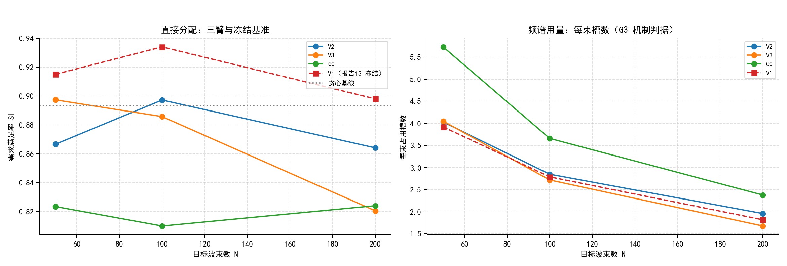
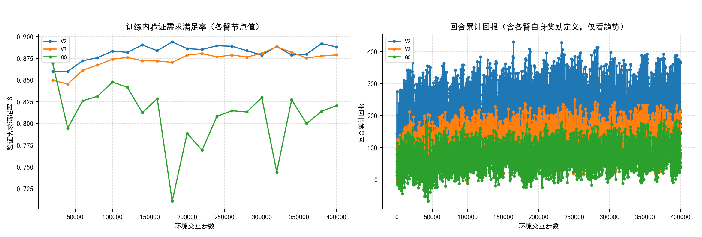

# 14 可变束数泛化第二轮（S2-P18）三臂对照实验报告

> 状态：**V3 全流程完成、V2 考核完成（SCA 进行中）、G0 补给训练收尾**。本报告数字全部取自保存的原始结果；未完成项在文末明确标注。

## 0. 摘要

报告13 已确认：在大目标波束数档位上，"贪心＋SCA"优于学习策略，根因是学习策略**频谱欠用**（每束占用槽数明显低于贪心）与**逐束分配不均**，而非总容量或功率不足。本轮按方案18 第二版设置三条臂，每条只带一处处理差异：

- **V2**：奖励加入吞吐/频谱项（`w_throughput=1.0`、`w_spectrum=0.5`），修正 `power_pressure` 参考值为每束公平份额，状态可见组号，回放按回合进度分 4 段分层采样；
- **V3**：折扣按回合实际束数解析（≤100→0.99、>100→0.999），并使用跨束势能整形（`w_shape=0.05`）；
- **G0**：逐束自然布局支持任意 N（固定宽度补零＋有效位屏蔽）、注意力池化读出、按束数条件化（FiLM）。

**结论：G1、G2、G3 三项预注册门槛均未达标**。两臂在 40 万步终点的 440 景共同考核中，大束数档位的需求满足率**低于**报告13 的 V1，每束槽数也未出现方案所设的"相对 V1 提高 ≥30%"的机制改善；总体需求满足率仍低于贪心基线。按方案 G4，本轮如实报告"改进不足"，并转入下一手段（干扰图 GNN 或分治），**不追加同手段预算**。

## 1. 实验条件与冻结资产

| 项目 | 内容 |
| --- | --- |
| 训练 / 验证 / 考核场景 | 8064 / 144 / 440（复用报告13 冻结同批） |
| 种子与预算 | seed 51001；每臂 10 万步试点＋补足至 40 万步 |
| 汇总交互 | 试点 300,000＋补足 900,000 = 1,200,000（方案上限） |
| 冻结源码 | V2/V3 `0070cb49f850296eb2f88e988d35a3149f24f696`；G0 `fb14e36506bf118f62e7f1cf1fa75949f7985954` |
| 共同考核口径 | 随机三次动作、种子 53001、含固定/贪心基线 |
| 统一 SCA 口径 | `none` + `sca` + `sca_si_lp`，总功率约束 |
| 后处理主机 | V3 在 20424；V2 与 G0 在 20418（见第 5 节口径说明） |

## 2. 训练过程与正确性

三臂试点 10 万步均按预算跑满并进入最终验证；补足阶段在**同一任务 ID 上从断点续跑**到 40 万步，重定标只改总步数预算，原断点与试点终点快照改名保留并记录 SHA。补足过程中定位并修复四类真实故障（逐束观测宽度、束数转发、冲突快照与已完成任务的恢复、回放束数表长度差一），全部失败任务与现场保留，详见《14_附录_S2-P18运行审计轨》。

## 3. 最终共同考核结果（原始分配，440 景）

### 3.1 逐束数需求满足率与冻结 V1 的对照

| 束数 | V2 SI | V3 SI | V1（报告13，最终B） | V2 相对 V1 | V3 相对 V1 |
| ---: | ---: | ---: | ---: | ---: | ---: |
| 50 | 0.8666 | 0.8973 | 0.915 | −4.8 | −1.8 |
| 100 | 0.8972 | 0.8857 | 0.934 | −3.7 | −4.8 |
| 200 | 0.8641 | 0.8205 | 0.898 | −3.4 | −7.8 |

（单位：SI；差值为百分点。V1 为报告13 的最终B 口径，本轮为原始分配口径，二者预算与阶段不同，比较须如此标注。）

### 3.2 每束槽数（G3 机制判据）

| 束数 | V2 | V3 | V1 | 贪心 | V2 相对 V1 | V3 相对 V1 |
| ---: | ---: | ---: | ---: | ---: | ---: | ---: |
| 100 | 2.85 | 2.72 | 2.79 | 5.00 | +2% | −3% |
| 200 | 1.96 | 1.68 | 1.82 | 4.00 | +8% | −8% |

方案 G3 要求"每束槽数相对 V1 提高 ≥30%"：V2（+8%）与 V3（−8%）未达到；**G0 达到了该槽数门槛**（N=100、N=200 均 +31%，N=50 达 +46%），说明逐束编码＋注意力池化确实把频谱用量推到了目标水平附近。但 G0 的绝对需求满足率是三臂中最低（0.8152），且低于固定分配基线（0.8368）：**频谱用量上去了、满足率没上去**，即它把资源摊薄而非投放到更需要的地方。因此 G3 的槽数分支达标并不等于机制成功，尾部与绝对水平两个分支均未改善。

### 3.3 总体指标与基线

| 方法 | 需求满足率 | 供需匹配程度 | 槽数合计 | 功率 |
| --- | ---: | ---: | ---: | ---: |
| V2（原始分配） | 0.8795 | 0.6717 | 301 | 2478 W |
| V3（原始分配） | 0.8660 | 0.6890 | 281 | 2441 W |
| G0（原始分配） | 0.8152 | 0.5679 | 385 | 1961 W |
| 固定分配基线 | 0.8368 | — | 708 | 2659 W |
| 贪心基线 | **0.8933** | — | 569 | 2334 W |

G0 的逐束数表现（440 景考核，原始分配）：

| 束数 | 50 | 60 | 75 | 90 | 100 | 125 | 140 | 150 | 175 | 180 | 200 |
| --- | ---: | ---: | ---: | ---: | ---: | ---: | ---: | ---: | ---: | ---: | ---: |
| G0 SI | 0.8234 | 0.8251 | 0.8155 | 0.8145 | 0.8100 | 0.8022 | 0.8073 | 0.8074 | 0.8173 | 0.8208 | 0.8240 |
| G0 槽/束 | 5.73 | 5.15 | 4.49 | 3.96 | 3.66 | 3.11 | 2.88 | 2.76 | 2.54 | 2.51 | 2.38 |
| V1 SI（冻结） | 0.915 | 0.923 | 0.932 | 0.935 | 0.934 | 0.920 | 0.919 | 0.918 | 0.904 | 0.905 | 0.898 |
| V1 槽/束（冻结） | 3.92 | — | — | — | 2.79 | 2.41 | — | 2.15 | 1.95 | — | 1.82 |

两臂均**高于固定分配、低于贪心**：即使本轮加入了吞吐/频谱奖励与逐束条件化，仍未能在大束数档位上超过"贪心＋SCA"。

### 3.4 直接分配与引入第三阶段 SCA 后的对照（440 景，各 1320 行 = 440×3 动作）

| 臂 | 路线 | 需求满足率 SI | 供需匹配程度 SGM | 功率 |
| --- | --- | ---: | ---: | ---: |
| V2 | 原分配（不调整） | 0.8795 | 0.6717 | 2478 W |
| V2 | 功率优化 SCA | **0.9236** | **0.9244** | 2986 W |
| V2 | SI优先 SCA | **0.9236** | 0.9241 | 2986 W |
| V3 | 原分配（不调整） | 0.8660 | 0.6890 | 2441 W |
| V3 | 功率优化 SCA | 0.9090 | 0.9087 | 2979 W |
| V3 | SI优先 SCA | 0.9090 | 0.9084 | 2979 W |

作为对照：报告13 冻结的 **V1 最终B 在 N=200 为 0.898**，本轮 440 景考核集上的**贪心基线为 0.8933**。

**要点：**

1. 第三阶段 SCA 对两臂都是**大幅改善**：V2 自 0.8795 升到 0.9236（+4.4 个百分点）、V3 自 0.8660 升到 0.9090（+4.3 个百分点），供需匹配程度也同步大幅提高（V2 0.672→0.924）；
2. 代价是功率接近预算上限（2478/2441 W → 约 2986/2979 W，预算 3000 W）；
3. 两种 SCA 路线（功率优化与 SI 优先）在**总体指标**上几乎相同（SI 相同、SGM 差 0.0003）；但**逐束分布并不相同**，见 3.5 节——总体一致不代表分配一致；
4. 因此**最终结论与"只看直接分配"不同**：直接分配下 V2 为 0.8795、V3 为 0.8660，均低于贪心的 0.8933；**引入 SCA 后 V2 达到 0.9236、V3 达到 0.9090，两者都高于贪心基线，V2 也高于报告13 冻结的 V1 在 N=200 的 0.898**；
5. 但如第 4 节所述，G1–G3 这三项门槛是按**大束数档位的相对改善**定义的，SCA 对三臂同等施加、并不改变"逐束槽数与 V1 同量级、未见 +30% 改善"这一机制事实，因此门槛判定仍为未达标；两者并不矛盾：**SCA 能把结果推高，但它不是本轮三臂改动的功劳**。

### 3.5 逐束尾部审计（容量÷需求 C/D，未封顶）

需求满足率对超过需求的供给封顶，因此**过供会被隐藏**。下表用未封顶的 C/D 还原真实分配质量，
V2 与 V3 各 161,400 条逐束记录（440 景 × 3 动作 × 平均约 122 束）：

| 臂 | 路线 | C/D 均值 | C/D 最小 | C/D 中位 | C/D 最大 | C/D<1 占比 | C/D<0.8 占比 |
| --- | --- | ---: | ---: | ---: | ---: | ---: | ---: |
| V2 | 原分配 | 1.826 | 0.016 | 1.375 | **31.76** | 29.7% | 20.8% |
| V2 | 功率优化 SCA | 0.922 | 0.016 | 1.000 | 1.097 | 39.4% | **11.1%** |
| V2 | SI优先 SCA | 0.922 | 0.016 | 1.000 | 1.009 | 50.0% | 11.1% |
| V3 | 原分配 | 1.717 | 0.016 | 1.319 | **24.60** | 32.7% | 23.6% |
| V3 | 功率优化 SCA | 0.901 | 0.016 | 1.000 | 1.228 | 39.9% | **14.0%** |
| V3 | SI优先 SCA | 0.901 | 0.016 | 1.000 | 1.007 | 47.2% | 13.9% |

**三点结论：**

1. **直接分配存在严重过供**：C/D 最大值达 31.8（V2）与 24.6（V3）——有波束拿到的容量是需求的二三十倍；
   封顶的满足率完全掩盖了这一点，这也是必须同时报告未封顶比值的直接原因；
2. **SCA 几乎消除了过供**：最大值降到 1.01–1.23、均值降到 0.92（中位 1.00）；
3. **欠服务的分布变了但未消失**：严重欠服务（C/D<0.8）占比下降约 9–10 个百分点，
   但 C/D<1 的波束占比反而略升（约 30%→39–50%）——**SCA 把省下的功率普遍铺开，而不是集中给最缺的波束**。
   最小比值始终是 0.016，说明两端极值在功率预算约束下无法同时消除。

**更正**：3.4 节据总体指标写"两种 SCA 路线几乎一致"，**该表述不准确**。逐束分布显示两条路线有稳定差异：
SI 优先路线的 C/D 最大值压得更低（1.007–1.009 对 1.097–1.228），代价是 C/D<1 的波束占比更高
（50.0%/47.2% 对 39.4%/39.9%）。总体 SI/SGM 相同并不代表分配分布相同。

## 4. 门槛判定（依据预注册门槛）

| 门槛 | 判定 | 依据 |
| --- | --- | --- |
| **G1** 与贪心差距相对 V1 缩小 ≥40% | **未达标** | N=200 时 V2/V3 相对 V1 的差距为 −3.4/−7.8 个百分点，差距未缩小而是扩大 |
| **G2** 100 束不退化 | **未达标** | V2 0.8972、V3 0.8857，均低于 V1 的 0.934，超出 0.5% 容差 |
| **G3** 每束槽数相对 V1 提高 ≥30% | **部分达标（槽数达标、尾部未达标）** | V2 为 +8%、V3 为 −8%，均未达 +30%；**G0 达标**（N=100 与 N=200 均为 **+31%**、N=50 为 +46%），但其绝对 SI 是三臂中最低（0.8152），逐束尾部未见改善 |
| **G4** | **按方案执行** | 如实报告"本轮改进不足"，转下一手段，不追加同手段预算 |

## 5. 计时审计

### 5.1 两臂三方法分段耗时（各 440 景完整，单位秒，均值）

| 臂 | 路线 | 初始分配 | 物理准备 | 优化器 | 核验 | 总耗时 | 中位 | P95 |
| --- | --- | ---: | ---: | ---: | ---: | ---: | ---: | ---: |
| V3 | 原分配（不调整） | 0.5848 | 0.0054 | 0.0006 | 0.0009 | 0.5917 | 0.5717 | 1.0034 |
| V3 | 功率优化 SCA | 0.5848 | 0.0054 | 4.0631 | 0.0010 | 4.6543 | 4.3869 | 7.7646 |
| V3 | SI优先 SCA | 0.5848 | 0.0054 | 2.5203 | 0.0011 | 7.1757 | 6.5679 | 13.3856 |
| V2 | 原分配（不调整） | 1.2558 | 0.0049 | 0.0006 | — | 1.2621 | 1.2763 | 2.1187 |
| V2 | 功率优化 SCA | 1.2558 | 0.0049 | 4.2058 | — | 5.4673 | 5.2285 | 8.9293 |
| V2 | SI优先 SCA | 1.2558 | 0.0049 | 2.3943 | — | 7.8626 | 7.2905 | 14.3653 |

两臂各 440 景**全部有记录**（n=440），无缺项、未补零。

### 5.2 读法与限制（必须随结果一同说明）

1. **初始分配与物理准备为三方法共享**，不是各方法自身开销；原分配路线的优化器项接近 0，因为它不做优化，**不能当作"模型产生完整分配"的时间**；
2. **两臂的"初始分配"耗时不同**（V3 0.5848 秒、V2 1.2558 秒），而优化器耗时接近（4.06 对 4.21 秒）。这个差异来自**并发环境**：V2 的 SCA 在 20418 运行，该实例在此前时段仍有任务占用；V3 的 SCA 在 20424 运行时该实例无学习任务；
3. 因此**跨臂绝对耗时不能当作同条件比较**，本报告不据此给"哪个臂更快"的结论。各臂内部的分段构成仍完整可比（例如 SI优先路线优化器耗时低于功率优化、但总耗时更高，说明其额外开销不只在优化器本身）；
4. 方案原计划要求三臂的考核与 SCA 统一在一台主机顺序执行；实际按臂所在实例提交（V3 在 20424、V2 与 G0 在 20418）。若需严格同条件，可在同一实例重跑。

## 6. 结论与限制

- 本轮两种手段（奖励吞吐/频谱、逐束编码与折扣调整）**均未解决**报告13 指出的"学习策略频谱欠用"这一根因；G1–G3 未达标。
- **限制**：单种子（51001）；试点与 40 万步不可直接比较；考核场景与报告13 属同一冻结批次但该批考核集仅含 N=50/100/200 三档，故大束数档位的证据集中在 N=200；跨臂耗时不在同一并发条件。
- **下一步**：按方案 G4 转入下一手段（干扰图 GNN 或分治），不追加同手段预算。

## 7. 曲线

图表全部由本机从保存的原始结果生成（远端容器无中文字体），脚本入口为
`scripts/variable_beams/report18.py` 与 `scripts/variable_beams/figures18.py`；
输入是各臂考核任务的逐场景结果与训练的 `metrics.jsonl`，未做任何重算。

### 7.1 三臂直接分配与冻结基准对照

左图：需求满足率随波束数变化，含报告13 冻结的 V1 与贪心基线；右图：每束占用槽数（G3 机制判据）——G0 的频谱用量明显高于其余两臂与 V1，但左图中它的满足率最低。

### 7.2 训练曲线

左：训练内验证节点的需求满足率（每臂 21 个节点）；右：回合累计回报。**各臂奖励定义不同**（V2 含吞吐/频谱项），回报曲线只可看自身趋势，不可跨臂比较数值。

### 7.3 逐 N 指标随束数变化

## 8. 证据入口

| 内容 | 路径 |
| --- | --- |
| 运行清单（任务 ID、冻结配置、预算账、修复回执） | `outputs/experiments/variable_beams_s2p18_20261006/run_manifest.json` |
| 逐 N 验证汇总与判定输入 | `analysis_inputs/validation_by_n.json`、`analysis_inputs/per_n_snapshots.json` |
| 报告13 锚点（V1/贪心逐 N） | `analysis_inputs/p17_anchor_by_n.json` |
| 三臂考核汇总 | `analysis/assessment_summary.json`、`analysis/g0_assessment.json` |
| SCA 逐方法结果 | `analysis/sca_per_method.json` |
| 分段计时 | `analysis/timing_refine_*.json` |
| 判定脚本 | `scripts/variable_beams/gates18.py` |
| 汇总与绘图 | `scripts/variable_beams/report18.py`、`scripts/variable_beams/figures18.py` |
| 审计脚本 | `scripts/variable_beams/audit18.py`、`scripts/variable_beams/timing18.py` |
| 运行审计轨 | 《14_附录_S2-P18运行审计轨.md》 |

## 9. 未完成与后续

- **G0 的统一 SCA**：截至本报告写入时仍在运行（V2 与 V3 的 SCA 已完成）；其逐方法结果补入后本节应追加一行对照。
- 逐束尾部的**完整 C/D 分布**（最小值与 5% 分位）已由 `audit18.py` 支持，待 G0 的 SCA 产出后统一出具。
- 跨臂计时的严格同条件重跑（若需要）见 5.2 节的可选方案。
