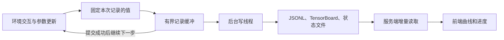

# 工程优化方案报告：异步采集与训练提速

日期：2026-09-29。适用对象：卫星资源分配工作台及G08六组欧洲航空场景实验。本文说明**已经实施的工程方案**；原始计时、数值核对、恢复证据和曲线见[验证报告](../实验报告/05_异步采集与训练提速验证.md)，最新任务进度见[实验状态](../../../EXPERIMENT_STATUS.md)。

**核心方案是：让GPU减少反复等待，让记录在后台按顺序写入，让页面只读取新增数据。** 保留原来的模型、业务需求、波束场景、奖励、随机种子和参数更新预算。用户可以稍晚看到进度，训练仍需保留完整的原始记录与可恢复断点。

这次已采用组合优化接续原六个任务。正式三任务共同训练的约120秒观察窗口，总更新速度从19.75升至37.83次/秒，约为原来的1.92倍；这是不同训练时段的观察值，不能直接当作整组40万步耗时缩短比例。

## 1. 原来为什么慢

原实现每次更新追加`updates.jsonl`，每50步写指标和原子状态；TensorBoard每次记录都flush。场景、验证和完整断点也在主循环执行。前端每隔数秒读取指标与TensorBoard，原读端反复全量解析。

另外，每次更新有五个网络参数和三个梯度集合的有限值检查，逐张量转为Python布尔值会让CPU等待GPU；许多诊断标量又分别传回CPU。因此不能预先把全部慢速归因于磁盘或页面。

把耗时分为：环境交互、参数更新、有限值检查/标量同步、JSON/TensorBoard、场景保存、固定验证、完整断点/学习快照、前端读取。某些计时区间相互包含，报告不得把重叠项相加当总耗时。

这里的“有限值检查”是检查模型参数和梯度是否出现`NaN`或无穷大。原实现经常检查一个张量，就让CPU等待一次GPU结果；模型包含许多张量，这些等待会反复发生。逐项诊断数值回传也有类似开销。

实测支持这一判断：同工作量的单对试测中，只改异步记录，13令牌网络耗时93.969→88.688秒，32令牌网络115.503→115.835秒，收益小且不一致；组合优化的多轮对照才显示稳定的大幅提速。因此最终方案同时处理记录、计算中的等待和页面读取。

| 改动 | 原来怎么做 | 现在怎么做 | 直接作用 |
| --- | --- | --- | --- |
| 训练记录 | 主循环频繁打开、写入和刷新文件 | 有界缓冲＋单个后台写线程 | 减少主循环等待磁盘 |
| GPU检查和诊断 | 多次逐项检查、逐个传回CPU | 条件合适时批量检查、集中回传 | 减少许多小计算和等待，是主要提速来源 |
| 页面主要指标读取 | 每次刷新重复解析历史指标 | 复用指标缓存，读取追加部分 | 降低刷新成本和CPU重复工作 |
| 断点和任务接续 | 已有完整断点恢复 | 保留原编号，增加严格的工程版本接续核验 | 原实验不中途作废，已训练进度可继续使用 |

## 2. 三层工程优化

记录和展示的关系如下。后台写线程负责文件，页面通过工作台服务读取文件；页面晚几秒更新不会要求模型停下来等待。

### 记录层：有界异步写入

- 同步模式保留作参照；异步模式由单个写线程按产生先后顺序处理完整原始记录，不抽样丢弃`updates.jsonl`。
- 主线程捕获并序列化记录，固定提交时的值，避免后台读到随后原地改变的数组或字典。
- 写线程长期持有JSONL文件句柄，批量刷新；默认目标间隔2秒、最大队列2048条。缓冲满时让主线程短暂等待，避免无限占内存。
- TensorBoard的写入、刷新与关闭都归写线程；状态文件保持临时文件＋原子替换，发布状态前写完此前的日志。
- `flush()`是明确的写出屏障。验证/断点边界、完成及关闭时等待记录写完；后台I/O异常传回主线程并保存失败记录，不能假装成功。
- 恢复时先执行写出屏障，再按最后完整断点的步数裁剪日志。断点之后的记录即使已经完整写出，也会被裁剪，避免恢复计算后出现重复；断点及以前的有效记录保留。对JSON损坏，只允许忽略尚未写完整的末尾片段，中间损坏会报错。

界面显示可能比计算进度晚，日志刷新间隔也不等于页面整体延迟上限：还受每50步采样、页面轮询和磁盘负载影响。显示记录时间与采集方式，避免把延迟误认为训练停止。

“不丢弃记录”指正常流程不会通过抽样或缓冲溢出丢掉原始日志。若进程被操作系统直接终止或机器断电，尚未写出的缓冲仍可能丢失；因此必须保留完整断点和恢复校验，不能承诺任意故障下每条记录都已落盘。

### 计算层：合并同步，不减少检查

仍检查每个参数、每个有效梯度和损失；仍用原梯度裁剪、相同阈值、相同优化器顺序。对满足条件的CUDA实数连续张量，用批量最大绝对值检查有限性，再集中取回检查结果；发现异常时再逐项定位。这里采用无穷范数，不使用可能因平方求和溢出的二范数。空张量、复数、非连续张量、CPU以及不支持批量运算的版本，自动走逐元素检查。诊断标量按设备和数据类型集中传回CPU。

不改变网络、奖励、掩码、场景、随机数流、训练预算或更新频率。不得以关闭异常检查、降低采样精度、改梯度裁剪或减少参数更新来制造速度收益。

可以把这个改动理解为：过去CPU反复问GPU“这一项检查完了吗”，现在先把同类检查放在一起完成，再集中取回结果。检查仍然存在，梯度裁剪仍按原来的规则执行；环境交互、动作选择等确实需要结果的地方，仍保留必要的等待。

### 展示层：增量读取

主要指标文件`metrics.jsonl`采用增量读取：服务端记住文件身份、偏移和不完整尾部，只解析追加内容；发现原子替换、截断或恢复时重新构建缓存。TensorBoard复用事件读取器，文件变化时再加载；其每个标签的缓存上限为10000个事件。事件日志、worker输出和历史CSV仍沿用原读取方式，因此不能说所有文件都已增量读取。

完整原始记录留在磁盘。页面对较长曲线仍会限制显示点数并保留分段极值，不等于逐点展示全部记录；指标按步覆盖和恢复清理的规则保持不变。缓存也有大小限制，避免长时间查看无限占用内存。读取提速与训练提速分别记录。

## 3. 哪些已异步，哪些仍同步

| 工作 | 当前执行方式 | 原因 |
| --- | --- | --- |
| 训练记录模块写出的更新、指标、回合等JSONL日志 | 后台线程按顺序写 | 允许延迟，但不能打乱或抽样丢弃 |
| TensorBoard写入、刷新与关闭 | 后台线程 | 减少训练线程反复刷新 |
| 状态文件发布 | 后台线程原子替换 | 写完之前的记录后才发布，避免页面进度超前 |
| 记录值捕获、JSON序列化、进入缓冲 | 主线程 | 确保记录描述的是当时的值，不受后续原地修改影响 |
| 波束环境计算、动作选择、反向传播和参数更新 | 原训练主循环 | 保持学习顺序和数据含义 |
| 场景文件保存 | 原同步流程 | 保留原始场景归档，当前并非主要瓶颈 |
| 固定验证、完整断点、学习快照 | 同步边界 | 保证模型、优化器、回放池和随机状态对应同一时刻 |
| 前端请求 | 独立服务端读取，复用增量缓存 | 不要求训练逐步配合页面刷新 |

验证与完整断点先保留同步。后台线程不能读取正在被优化器修改的模型或经验池；完整状态、优化器、回放和随机状态必须来自同一边界。若将来异步化这两项，需要另做不可变快照、待评价任务恢复及最佳模型版本一致性验证，不能仅把现有函数放进线程就认为安全。

本轮保留相同验证次数和断点频率，以便判断真实工程收益。用户关注的“纯算法”作为不含观测I/O、验证和保存的参考窗口单列，不把其简化工作量当完整实验速度。

例如，保存模型的同时若优化器还在修改参数，后台保存程序可能读到一部分旧参数和一部分新参数。完整断点还包含优化器内部状态、经验回放和随机状态，这些也必须对齐。因此本次没有简单地把验证和保存全部放进线程；是否进一步异步化，应先设计不可变快照并独立核验其正确性和资源成本。

## 4. 验收协议

先试测原冻结版、仅异步记录版和组合版以定位瓶颈；再将最终组合版与原版按A/B/B/A交替各测3轮，另用相邻窗口比较组合版与关闭观测I/O的纯算法参考。取原13令牌与32令牌两类代表，相同种子、实际欧洲场景、初始化、优化器和回放起点。纯算法参考保留相同异常检查，不代表硬件的理论极限。

- 稳态段包含500次真实参数更新及相同频率的日志/指标/场景记录；运行时和动作指标采用固定子集，属于计时用短循环，不能当成完整训练入口的全流程。另用真实训练入口触发验证、断点与缓冲写出，检查这些路径的等价与耗时。
- 边界段使用人为安排的步号触发事件，只是工程测试，不能算作新增正式训练进度。100步就做一次验证会夸大验证占比，不能直接推算40万步提速。
- 正式三GPU作业不停，因此测量记录同期任务阶段、GPU负载；报告有竞争背景，不声称独占GPU。边界测试的经验池比成熟正式任务小，不能把短检查的断点耗时直接外推为40万步总时间。
- 科学等价检查包括动作、奖励、场景、网络、优化器、回放、随机状态、指标、恢复后的继续更新；允许差异只限时间戳、运行耗时与记录方式等预先声明的操作字段。
- 初步部署门槛为两类布局在同工作量多轮比较中均至少提升5%，且科学等价、日志完整和恢复检查通过。单次日志微测或单对结果不能决定切换。

已经得到的结果如下，各行的计时范围不同，不应混成一个“总提速倍数”。

| 核验口径 | 已测结果 | 能说明什么 |
| --- | --- | --- |
| 两类网络各3轮同工作量交替短测 | 13/32令牌吞吐为原来的2.66/2.46倍 | 组合优化在受控短循环中有效 |
| 保留异步记录与关闭观测I/O的相邻窗口，各1对 | 额外耗时约0.7%/2.1% | 该短循环已接近保留同样安全检查的纯算法参考 |
| 正式三任务均在训练的约120秒窗口 | 总更新19.75→37.83次/秒，约1.92倍 | 成熟经验池和正式主循环中也观察到收益；不是同训练位置的受控重跑 |
| 100次更新内特意触发一次完整验证和保存 | 两布局耗时分别减少12.0%/3.1% | 验证、保存仍有成本；此处事件频率远高于正式训练，不能外推40万步 |
| 同一份日志副本的页面指标读取 | 原全读约1.5–1.7秒；新版缓存/追加读取约0.05–0.07秒，首次读取仍约1.56秒 | 改善重复查看速度，不能计作模型训练提速 |

351项CPU回归检查中1项跳过、其余通过；另有真实CUDA更新、异常数值边界、12对稳态结果以及两类网络的完整短断点恢复核验。权重、优化器、经验回放、随机状态、动作、奖励和科学指标均按相同输入比较。原始样本图、测试来源与局限见[完整验证报告](../实验报告/05_异步采集与训练提速验证.md)，不需要为了本说明文档重复训练。

下图复用已保存的正式任务原始记录：蓝绿色线为切换后共同训练窗口，红线为切换前窗口，灰线包含A/B的周期验证。灰线的平台对应验证等待，不代表训练卡死。各窗口约120秒，使用相同训练种子51001但位于不同训练进度，无平滑；完整输入与绘图说明见验证报告。

## 5. 已有任务怎样安全接续

不改正在使用的冻结目录。优化通过后由工作台建立新冻结快照，凭绑定旧/新提交、文件SHA、等价证据与实测收益的记录进行明确升级，不能冒用历史原子替换修复类型。

排队任务在未启动时更新绑定；运行任务一次只交接一个，在完整回合边界保存全部断点，经同一任务编号恢复，其他任务保持计算。短时限制新任务抢占空出的槽位，限制有超时自动释放；不终止已运行的其他任务。严格核对交接前后步数、更新次数、场景游标、权重/优化器/回放/RNG及新导入路径，不重置训练预算。

本轮沿用单GPU最多3路作业的队列安排。每个任务使用冻结源码运行，日常文档编辑或代码仓库后续变化不会改变其正在使用的文件；后台进程也不依赖浏览器保持打开。

若校验失败，保留现场并按旧源接续。后台共同评价的接续清单也须同步有效版本及来源链，避免训练已升级而后处理误认版本改变；原审批与原始冻结信息保留，不覆盖历史。

## 6. 前端操作与故障处理

前端增加同步/异步记录选项、目标刷新间隔与缓冲容量，任务和模型保留完整操作配置；这些参数不参与学习语义哈希。监控页显示记录方式和时间，恢复、升级与调度限制走工作台任务流程。

当前G08六组采用“异步批量记录”，目标刷新间隔2秒、缓冲容量2048条。页面保存的选项会经过服务端校验，进入任务配置和模型元数据，并真正传给训练程序；配置页与正式监控页均做过实际操作核验。同步方式仍保留，用于兼容和对照。

后台写入若报错，会把错误传回主循环并保存失败状态；若缓冲满，训练会等待，不无限积压内存。版本切换采用完整回合边界、完整断点和同任务编号恢复，一次只切换一个运行任务。GPU原生故障仍需单独检查：本轮C2曾在0步发生CUDA驱动模块异常退出，已保留现场并通过原任务/初始断点恢复排队，根因尚未确定，不能说异步方案可以避免所有驱动故障。[故障与恢复证据](../../../outputs/experiments/europe_ablation_20260929/recovery_20260929_1350/recovery_summary.json)；实际是否重新产生更新以[最新实验状态](../../../EXPERIMENT_STATUS.md)为准。

验证产物放在`outputs/verification/async_telemetry_20260929/`，包括代码指纹、组件计时、逐位对照、原始JSON/TensorBoard核验、吞吐样本和迁移记录。G08仍只有六组、seed51001、每组40万步；工程短检查不计为新增训练成果。

## 7. 维护入口

| 模块 | 负责的工作 |
| --- | --- |
| [telemetry.py](../../../src/satellite_rl/workbench/telemetry.py) | 有界缓冲、顺序写入、刷新屏障、异常回传与关闭 |
| [runner.py](../../../src/satellite_rl/workbench/runner.py) | 训练记录接入；验证、保存和恢复的一致性边界 |
| [workbench_algorithms.py](../../../src/satellite_rl/agents/workbench_algorithms.py) | 有限值检查和标量回传的等价加速；梯度裁剪不变 |
| [monitoring.py](../../../src/satellite_rl/workbench/monitoring.py) | 日志及TensorBoard增量读取，截断与替换检测 |
| [config.py](../../../src/satellite_rl/workbench/config.py)、[app.js](../../../src/satellite_rl/workbench/static/app.js) | 前端选项、服务端范围校验与页面说明 |
| [performance_upgrade.py](../../../src/satellite_rl/workbench/performance_upgrade.py)、[runtime.py](../../../src/satellite_rl/workbench/runtime.py) | 基于已核验凭据的同任务接续、来源备份与短时派发保留 |

G08的切换流程与后处理衔接脚本保存在[迁移目录](../../../outputs/verification/async_telemetry_20260929/migration)，均保留明确的检查门槛与执行记录。该一次性流程只用于本次已批准六组，不是未来所有任务自动改变源码的通用许可。

本次报告完善按项目轻量文档流程核对源码、原始数字和链接，未修改训练程序、前端或参数，也未为写报告重跑训练；现有前端无需同步改动。
