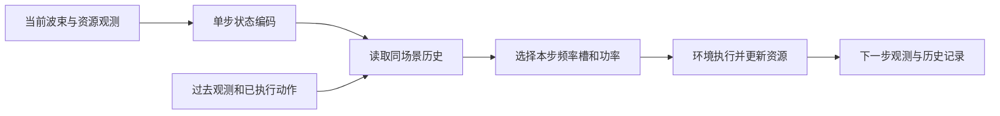

# 分配记忆、干扰关系与联合动作建模：算法调研方案

日期：2026-10-01。提案P07。**仅调研与方案，未修改算法、前端或数据，未启动新训练、评价或自动跟进。** G09已完成；[方案12](12_207维全局信息消融与稳定性验证方案.md)的P06字段消融仍是独立候选，不与本方案自动累计预算。

**同日后续执行状态（按最新授权更新）：**J0–J3的G10已完成，见[训练说明14](14_联合动作四组远端训练说明.md)。用户又明确批准M四组、G三组以及两组固定温度实验，已按[G11说明16](16_温度记忆与干扰图双实例实验说明.md)在双4090D提交九任务。本页保留提案时的论证与候选语气；P06和未选择的其它方向仍未因这次授权而启动。

## 1. 推荐结论

值得从“增加状态字段”进入“改变模型怎样理解关系、怎样做联合决策”。推荐研究主线是：**面向波束干扰与剩余资源的条件资源分配方法**，重点研究频率槽与功率的联合价值、波束间物理关系，以及同场景分配历史是否有用。

优先顺序为：先验证联合动作表示这一明确的结构限制；将历史记忆作为独立研究支线；再以同信息对照研究逐束干扰关系编码。模块分别有效后，再设计组合消融。仅把SAC加上Transformer、GRU或GNN，不能直接称为原创算法；这些都有成熟先例。论文贡献应落在针对本任务的新表示/决策机制、可解释的性质和受控实验上。

本轮G09已说明：207维N1综合服务较好，246维N2的平均SI略高但基本服务完整性较差，2946维没有整体领先。它支持“信息要有合适的表达”，不能证明历史记忆、图网络或联合动作结构一定有效。固定旧奖励、dropout0、场景重排和单seed51001，先把算法结构的作用分开验证。

## 2. “把t的输出拼到t+1输入”是什么

这个想法可以实现为两类机制：

1. **上一动作作为新输入。** 下一束分配时，让模型看到上一束实际用了哪个起始槽、多少槽、多少功率。这是一步历史增强，仍可用普通前馈网络，并不自动成为Transformer。
2. **记住一段分配经历。** 除了当前观测，保存此前多束的观测和动作；GRU把历史压缩为一个内部状态，因果Transformer在历史记录中选择与当前决策有关的部分。

用递归网络举例：`h_t = F(h_(t-1), o_t, a_(t-1))`，再由`π(a_t | h_t)`生成本步动作。`o_t`是当前观测，`a_(t-1)`是上一步已执行动作，`h_t`是网络记忆。用Transformer时，记忆通常是一段历史令牌及其缓存，不必只是一根递归向量。注意力机制让模型按内容查询历史，而不是把输出不断拼长就自然获得可靠记忆。



**这里的t是当前场景内第几次波束分配，不是飞机飞行的真实时刻。** 现有一回合固定位置与需求，连续处理100束；动作改变功率、占用、干扰和服务。不同ADS-B时刻被构造成不同场景，并在训练中重排。每次换场景必须清空记忆，不能把前一个随机场景拼成当前飞机的飞行历史。将来要研究连续移动，须另建按UTC排序的多时刻环境、跨时刻波束身份、重分配与切换成本；本方案不宣称已经实现。

## 3. 当前实现的三个结构特点

| 已核对的事实 | 对研究方案的含义 |
| --- | --- |
| 当前Transformer把同一步的地理、需求、功率、槽干扰/占用等拆成令牌，输入为`[batch,state_dim]`，没有跨步缓存 | 当前已有状态内部注意力；加入历史是新机制，不能只改名称 |
| Replay逐条随机抽取`状态、动作、奖励、下一状态、终止` | 真正记忆网络需要连续历史回放和对应的训练/评价/恢复支持 |
| 合法频率与槽数组合按两头logit相加后归一化，功率另行采样；每个Critic把三头Q相加 | 掩码已保证资源动作可行，但可学习的动作配合受到限制 |

参照源码：[网络](../../../src/satellite_rl/agents/workbench_networks.py)的`Encoder.forward`/`MultiHeadNetwork`、[学习器](../../../src/satellite_rl/agents/workbench_algorithms.py)的`Replay`/`_joint_q`/`_update_masked_sac`、[动作掩码](../../../src/satellite_rl/agents/action_masking.py)的`masked_policy`、[环境](../../../src/satellite_rl/workbench/environment.py)。已对照[原T-SAC论文第4页](../../资料/02_Transformer-Enhanced%20SAC%20for%20Joint.pdf)：其状态子字段令牌化和逐束单步回放描述，与“天然具有跨场景时间记忆”不是一回事。

准确地说，掩码会使起始槽f和槽数l在统计上相关，不能称三个动作完全独立。但合法`(f,l)`的相对打分仍是行项加列项，功率p也没有显式依赖已经选定的`(f,l)`。两个Critic各自都是`Q_i(s,f,l,p)=q_F,i(s,f)+q_L,i(s,l)+q_P,i(s,p)`。对两个完整Q取最小值可能产生分段交互，却不能代替一个有明确交互项的价值模型。

## 4. 方向一：频率槽与功率的条件决策——优先验证

### 4.1 要解决的实际问题

同一个波束，选择多少槽、在哪段频率上分配、配多少功率应相互配合：带宽、单位带宽功率和干扰共同影响容量。当前网络的动作合法性已经处理，但它对合法组合的评价和采样仍有结构限制。这是代码事实；它是否造成G09的低功率或服务缺口，尚未做因果验证。

可以用一个小例解释限制：固定状态和起始槽，比较两种槽数与两档功率。如果四个组合收益的交叉差`Q(l1,p1)+Q(l2,p2)-Q(l1,p2)-Q(l2,p1)`不为0，单个加性Critic无法同时精确表示。环境容量通常有联合作用，但应该先在保存的合法状态中验证，不能拿任意即时奖励例子直接证明全部长期Q都存在同样差值。终止前一步的真实奖励可提供更清楚的探针，因为终态不再自举。

### 4.2 候选方法

策略改为：`π(f,l,p | s)=π_FL(f,l | s) × π_P(p | s,f,l)`。先选一段合法连续频率槽，再依据这段频率、槽数和当前状态选功率。也可继续拆成“起始槽→槽数→功率”，这叫动作内部的自回归：后一个动作分量以已经选好的分量为条件。它与跨波束的时间记忆是两件事。

首版建议`π_FL`直接打分100×10种配对，`π_P`输出每种配对下10档功率的条件分布。价值网络用两套`Q_i(s,f,l,p)`评价整个组合，先考虑向量化的10000项全表，或状态与动作嵌入组成的联合打分器。若真实吞吐/显存不合适，再另立低秩交互版本；不能把三个加性头换个名字叫联合Q。

目前最大动作数为100×10×10=10000，不意味着每步要执行一万次环境交互。对一个回放状态在网络中计算这些候选的分数和概率即可；可行掩码排除非法组合。额外的网络计算量、显存和推理耗时必须实测。

逐维条件动作已有[Metz等2017论文](https://arxiv.org/abs/1705.05035)先例；[离散SAC论文](https://arxiv.org/abs/1910.07207)支持对离散动作求策略期望。这些来源不证明本项目会提升，具体资源条件策略与可行集合设计属于本方案待验证内容。

### 4.3 学习公式必须一起对齐

对真实合法集合`A(s)`，使用同一个联合概率做动作采样、价值目标、Actor损失和熵：

```
V_target(s') = Σ_a π(a|s') [min_i Q_target,i(s',a) − α log π(a|s')]
y = r + γ(1−done)V_target(s')
L_Qi = E_replay[(Q_i(s,a) − y)^2]
L_actor = E_s Σ_a π(a|s)[α log π(a|s) − min_i Q_i(s,a)]
H(π) = H(π_FL) + E_(f,l) H(π_P(·|s,f,l))
L_alpha = logα × E_s[stop_gradient(H(π)) − H_target(s)]
```

求和只覆盖对应状态的合法动作。终态直接`y=r`，不访问下一步空掩码。保留当前温度更新符号和`H_target(s)=ρlog|A(s)|`的定义；原6.9通过`ρ=6.9/log10000`解释，不能把三个头的独立熵直接搬到新条件策略。Actor保留概率梯度、冻结Q在该损失中的参数梯度；离散采样没有连续动作式的路径导数，不用“采一个动作再直接反传”代替正确期望。

当前掩码是合法`(f,l)`与合法功率的笛卡尔积；条件策略首版保持这个资源规则，不新增服务或槽数—功率约束。未来若合法性本身耦合，须建立完整三元组掩码并重算合法集合大小。

### 4.4 推荐首轮四组

全部使用207维、相同旧奖励与场景，只有动作表示改变。

| 组别 | 策略 | 双Critic | 回答的问题 |
| --- | --- | --- | --- |
| J0 | 原掩码策略 | 原加性Q | 同平台参照 |
| J1 | 原掩码策略 | 联合Q | 联合价值表达是否有益 |
| J2 | 条件策略 | 原加性Q | 仅改策略参数化的对照与价值限制 |
| J3 | 条件策略 | 联合Q | 二者配合是否改善服务和学习 |

建议单seed51001、各400000交互步，**这个模块候选总预算160万步**。可从J1−J0、J3−J1等比较作用；J2在弱Critic下无提升不能证明条件策略永远无效。四组参数量自然不同，需独立统计各网络而非旧`Actor参数×5`的简化计数。旧G09 N1作历史背景，新J0须与新实现同条件运行。

解释J2时需注意：如果Actor所用价值本身是加性的，当前笛卡尔积可行集下的最优熵策略就能由旧分解分布表示；但当前实际使用`min(Q1,Q2)`，它未必加性。例如两动作分量取0/1，`Q1=l−p`、`Q2=p−l`，其最小值为`−|l−p|`，有配合关系。因此J2仍是有效的仅改策略对照，但其改善不能单独证明Critic已经学到了真实联合Q；条件策略在联合价值下的附加作用主要看J3−J1。

## 5. 方向二：跨波束分配记忆——直接检验用户提出的想法

### 5.1 为什么可能有用，也可能没有用

当前207维已有剩余功率、本组逐槽占用/干扰等历史摘要。若摘要已足够，记忆会增加计算而不增加有效信息；若过去分配方式影响未来但未被当前观测充分表达，历史可能补足它。历史也不能凭空恢复从未观测过的未来波束位置或需求，不能宣称加入记忆后必然成为完整状态。

可优先检查同等当前资源摘要下不同分配历史是否对应不同后续服务，以及失败是否跨8组轮询出现；这为历史长度提供依据。GRU应作为必要的简单对照，不能因Transformer较复杂就预设它更好。[Ni等ICML 2022](https://proceedings.mlr.press/v162/ni22a.html)说明精心实现的递归模型自由RL在其部分可观测任务中是强基线；[GTrXL，ICML 2020](https://proceedings.mlr.press/v119/parisotto20a.html)则表明标准Transformer用于RL也可能难优化，并研究了门控稳定化。

### 5.2 可执行的最小比较

首版每步输入为原207维，加上一束的**实际执行**起始槽、槽数、功率三个归一化量，以及“上一动作是否存在”一位，合计211个有含义的数。采用环境`info.actual_action`里的`freq/99`、`slots/10`、`power_w/50`；当前Replay中的动作是请求的离散索引，不能代替这份实际执行记录，新增回放需专门保存它。首步上一动作不存在，用有效位屏蔽其三个值；这些表示缺失历史，不是为对齐网络而补无意义字段。此次211维与历史P05的211维字段完全不同。首版不加上一奖励，避免同时引入额外奖励信息。

| 候选 | 观测与历史 | 用途 |
| --- | --- | --- |
| M0 | 当前207维，无跨步记忆 | 参照 |
| M1 | 当前211维，只看上一动作 | 用户所说“拼上一输出”的最简单版本 |
| M2 | 与M1相同字段，用GRU处理同场景历史窗口 | 检验多步历史的作用 |
| M3 | 与M2同字段、同窗口，改用因果Transformer | 检验注意力是否比递归记忆更合适 |

建议候选窗口K=16，包含当前步、最多15个过去步骤，可覆盖多个8组轮询位置；它只是待预检的工程起点，不是已验证最优。各步先做单步资源编码，再做时间编码，首版不把16×14个原始资源令牌全部混成一个巨大序列。M2/M3共同使用此窗口与同一回合前缀，在线也按相同窗口重建，不偷偷让GRU携带整个回合而Transformer只看16步。

若专门实施本支线，四组各40万步也是**独立候选160万步**，不是J模块之外默认追加的预算。M0/M1/M2/M3解释了上一动作、较长历史、时间编码方法的区别，但没有单独拆出参数量收益；结果须报告这个限制。只有M3在同历史条件下优于M2，才支持使用更复杂的Transformer。

### 5.3 训练与恢复的必要改造

不能只改`act()`。回放须保存场景/回合ID、步序、原始观测、实际动作、当前/下一步掩码与真实终止；为每个被学习的决策重建当时可见历史。建议首版按256个目标决策位置采样，每位置附最多K步上下文，只在目标位置加一个SAC损失；上下文参与编码、可以传播梯度，但不能额外算成K个TD目标。这样保留每次更新256个有效目标的口径，同时如实记录增加的历史前向/反向工作量。

精确索引为`x_t=[o_t, actual(a_(t−1)), valid]`。本步窗口是`[max(0,t−15), t]`；非终态下一步目标窗口是`[max(0,t−14), t+1]`，其中`x_(t+1)`只含刚执行的`actual(a_t)`，绝不含`a_(t+1)`。终态目标直接等于r、不读取下一掩码。GRU在窗口左端使用固定零初始记忆，Transformer读取同一有效序列；短窗口用实际有效长度/遮挡，训练、验证、考核的缺失历史规则相同。

上下文梯度来自在线Actor或在线双Critic各自的目标位置损失；构造bootstrap时，下一步Actor及目标Q全部在`no_grad`下各自重建窗口。首版保存原始历史并按当前网络重算，避免每步更新权重后沿用旧版本隐藏状态；不加入跨片段缓存。不同形状结构不能要求全部初始参数逐位一致，报告共同模块初始化与新增模块的差异。

该窗口方案从已知窗口起点初始化，训练和推理规则相同。若后续采用长片段或Transformer-XL缓存，才加入额外的前缀预热：先重建内部记忆、前缀不计损失，并检查是否截断梯度。在线Actor、双Q和双目标Q分别重建自己的历史表示，不能直接混用旧网络保存的隐藏向量。[R2D2](https://openreview.net/forum?id=r1lyTjAqYX)讨论了序列回放与隐藏状态陈旧问题，但其DQN损失不能原样移植到SAC。

禁止以下泄漏：本步动作进入本步决策输入、下一步动作进入下一步目标输入、最终全100束成绩进入中途观测、片段穿过随机场景边界。当前场景预先已知的需求/位置可按共同观测合同使用，它与尚未发生的动作和服务结果不同。每次训练回合、验证场景和考核场景重置历史；断点保存序列、采样RNG与必要环境/缓存，或在回合边界保存完整状态。

普通因果Transformer首版不宣称实现了完整Transformer-XL/GTrXL。若门控或跨片段缓存作为新增因素，应另作对照。[Transformer-XL](https://aclanthology.org/P19-1285/)为语言序列的跨片段复用提供参考；[Decision Transformer](https://arxiv.org/abs/2106.01345)原方法用离线轨迹和目标回报条件生成动作。保留在线SAC更新而加时间编码，不等于Decision Transformer；旧实验日志也不能自动当成高质量离线教师数据。

## 6. 方向三：按波束和干扰关系编码——更贴近未来地理变化

G09的布局/完整档把每10束展平后压成一个令牌，这保留了数值，但并未显式告诉网络“哪一束会干扰哪一束”。可以改为每束一个共享编码的令牌，包含已有位置、需求、组别、处理顺序及当前分配字段；当前束作为查询，同时看其他束和8组资源。已知未分配波束可以提供位置与需求，但未发生的分配和服务必须标记为未知。

进一步依据现有方向图、传播模型与频率关系建立有向边：`j→i`表示j的发送可能影响i。几何耦合、当前已分配功率、真实槽重叠等进入注意力偏置或消息计算。候选形式是`score_ij=q_i·k_j/√d+b(edge_ij)`，其中`b`由归一化物理关系产生。强耦合不等于只能是负权重；先让网络读取强弱关系，而不是未经验证地把远处干扰截为零。未来动作导致的重叠只能在候选动作评价时计算，不能当成已知终态输入。

[Set Transformer，ICML 2019](https://proceedings.mlr.press/v97/lee19d.html)提供集合交互编码方法；[Graphormer，NeurIPS 2021](https://arxiv.org/abs/2106.05234)说明将结构信息送入注意力的建模方式；[Shen等无线资源管理论文，JSAC 2021](https://arxiv.org/abs/2007.07632)研究了利用通信图结构的资源分配网络。这些提供方法依据，均不直接证明本项目的SGM或基本服务会改善。

建议先以**同一套2946维原始字段**比较：

| 候选 | 输入事实 | 编码 |
| --- | --- | --- |
| G0 | G09完整档相同字段 | 现有32令牌、每10束一段 |
| G1 | 与G0相同字段 | 每束1令牌，共13＋1＋100＋8=122令牌 |
| G2 | 与G1相同原始字段与物理合同 | 122令牌＋显式干扰关系 |

G1−G0检验逐束表达，G2−G1检验物理关系设计；它们与207维比较时仍包含信息量差异，不能把全部收益归给图结构。首版边只使用2946维中已有的位置、组别、实际分配字段及共同固定的传播/方向图常量来确定，明确角度、W、线性增益与dB转换。若引入原输入无法确定的新信道信息，须给所有对照同一信息并按实际新维数重新冻结，不能仍假称2946维同信息。

仅置换输入记录的存储顺序时，要同步置换边与当前束索引，保留真实组别、执行顺序和束身份，检查输出对应关系不变。改变实际处理顺序会改变当前`beam_idx%8`分组含义，不能与排列不敏感测试混在一起。能接收变长令牌不代表已经验证不同波束数量泛化；当前100束环境规则不在本轮随意修改。

如果实施该模块，三组各40万步，**独立候选120万步**。N4历史权重不能充当新实现新平台下唯一对照。122令牌相对32令牌会增加注意力计算，必须报告真实训练和推理开销。

## 7. 其他值得保留、但后置的手段

| 方向 | 适用理由 | 当前为什么后置 |
| --- | --- | --- |
| 分配后有限次修正/局部搜索 | 初始100束分配后，允许交换槽段或调整功率，改善早期不可撤销决定 | 改变动作过程和计算预算；须比较策略本身、同搜索预算启发式及组合，不能把搜索计算当网络能力 |
| 基本服务约束学习 | 把未达10%需求的束数或全束失败作为单独成本，更明确约束服务 | 先查物理可达性；期望成本约束不保证每场景每束成功，拉格朗日法也会改变学习目标，不能冒称仍是完全相同旧奖励实验 |
| 物理模型辅助的短前瞻 | 用已知环境比较少数候选对后续干扰和预算的影响 | 可测总推理时间和真实收益；不要无必要先训练世界模型，再引入模型误差 |
| 多步回报、Huber、温度或学习率调整 | 可改善某些数值或信用分配问题 | 属于优化与稳定性专项；先用TD/Q/熵证据定位，不同时混入结构消融，也不把常规调参作为主要创新 |

学习改进已有[Wu等路由改进启发式](https://arxiv.org/abs/1912.05784)先例；[CPO](https://arxiv.org/abs/1705.10528)是受约束策略优化参考。前者不是本项目的卫星策略，后者的理论条件与优化器也不能直接转移到当前离散SAC。

## 8. 什么才可能形成论文贡献

建议用“**干扰关系感知的条件资源分配**”作为工作主题，而不是先给组合方法取新缩写。候选贡献分别是：

1. **物理结构的表示：**共享逐束编码、不同100束地理布局和有向干扰关系，说明它如何影响全部波束终态服务；在同原始信息下消融，而不是仅增加信息。
2. **资源动作的协同：**合法连续槽段与条件功率策略、联合Q和一致的熵/价值更新，解释为什么可行性约束之外还需要配合建模。
3. **历史的必要性：**明确当前观测丢失了哪些分配信息，比较一步输入、GRU和因果注意力；若记忆无收益，就保留该负结果，不强行加入最终方法。

贡献是否成立，需要与已有方法做更全面的近邻工作比较及实验，不预先宣称“首次”。例如2025年[卫星GATE预印本](https://arxiv.org/abs/2511.16011)已经把图卷积、时间卷积和混合PPO用于服务迁移与资源分配；其问题/算法不同，但足以说明“卫星＋图＋时间”这一组合本身不新。当前调研是定向路线筛选，不是穷尽所有相关论文的新颖性证明。

## 9. 建议执行顺序、评价与停止条件

**近期优先J模块四组。** 它保持207维和旧奖励，直接检验代码中已定位的动作结构限制。用户提出的记忆先按M模块设计小型正确性/表达探针；若要把记忆作为论文主线，可将M四组作为首轮，两个模块不一次全部开跑。G模块用于之后的地理泛化主线。P06研究字段作用，可保留或另行安排；本文三个模块的候选预算不自动累加成待运行队列。

每个正式模块均同4090D/DQN/CUDA、同场景、seed51001、各40万环境交互、固定终点选择。保持旧奖励/dropout0/shuffle、物理资源与掩码规则。对历史回放，除了优化器更新数还统计有效TD目标数量及上下文计算量，避免相同40万步但一个模型多学习16倍而未说明。已核同源码/配置/设备/初始化与评价条件的参照可复用；不满足时不能为省事硬复用。

验证按[方案12](12_207维全局信息消融与稳定性验证方案.md)的固定场景和早期节点建议，新增节点需要实现并保护训练RNG。主结果仍用固定40万步终点；01-19已参与开发选择，新模块最终考核须在方案选择前冻结新的共同100场景/日期，不用考核挑结构、超参或节点。每模型同场景3次动作，先场景内平均，再按100场景配对；不把300动作当独立场景或训练种子。若阶段性决定来自验证集，新最终考核可以留到最终方案固定后再揭盲。

至少展示原始训练回报＋100回合均值、固定验证原节点、TD/Q/α、全100束最终SI/SGM/基本服务、功率/槽数及约束。报告低服务尾部和按需求/干扰分层的表现，注明单种子限制。分别记录训练吞吐、GPU时长、显存、每100束端到端推理耗时（含历史重建/物理边计算/后处理），区分交互样本效率、计算成本和模型效果。

如果新结构只增加耗时而没有服务或泛化收益，就不纳入最终方案。如果仅均值提升但基本服务或约束明显退步，应如实报告取舍。奖励平台只支持本次运行趋稳，不能保证单调或数学收敛。组合方案只有单模块结果支持后才新增消融，预算另行记录。

## 10. 实施前必须通过的检查与前端同步

- 联合动作：人工四格交互、手工枚举对照、概率总和1/非法概率0、条件熵、温度梯度号、终态不自举、整组动作双Q最小值。区分随机执行与联合最大概率执行，不能让逐头argmax冒充联合argmax。
- 历史：首步/终止/场景reset、输入时间错位、未来信息遮挡、相同窗口在线/离线结果、目标网络历史、有效样本计数和完整恢复。
- 图：方向/增益/功率单位、真实重叠、边与节点置换、未分配状态、当前与终态干扰一致，图表不能把注意力权重单独当因果解释。
- 全部：真实CUDA参数更新、保存/严格加载、独立输出、旧模型兼容及资源账；只有公式/前向通过不能冒充学习提升。
- 前端：时序模式/窗口、动作策略/价值结构、图编码、真实输入字段和形状、各网络参数量、学习样本与更新数、状态日志、模型/断点版本均须从页面经过服务端校验传到冻结任务和评价。实现时实际操作页面验证。旧模型历史记录保留。

本次按`satellite-rl-change-eval`方案/文档分支完成：读取当前代码、G09报告与原T-SAC参考PDF，检索原论文/作者来源，两项Sol独立审查，维护状态与问答。PDF仅作文本内容核对，未改写或重新排版。研究备忘录与来源指纹保存在[调研证据目录](../../../outputs/verification/algorithm_innovation_research_20261001/)。**所有新增算法效果待验证，本次没有正式训练预算被执行。**
